# Methodology

The independent library renders calibrated ECG paper and camera captures from 12-lead signals. It is a data-generation component without a trained clinical inverse model.

# How rendering works

A waveform remains a waveform throughout rendering. The library changes how it is printed and photographed, and provides the mapping needed to supervise the resulting image.

## Input contract

| Quantity | Contract |
| --- | --- |
| Signals | Floating tensor `[B,12,T]`, in mV |
| Lead order | `I, II, III, aVR, aVL, aVF, V1, V2, V3, V4, V5, V6` |
| Sample rate | Positive scalar or `[B]` rates, in Hz |
| Padded lengths | Optional `[B]` valid source lengths, each ≥2 |
| RGB | Float32 `[B,3,H,W]`, values in `[0,1]` |
| Device | Signals and module on the same device |

The default maximum printed duration is 10 seconds. Duration uses `(length-1)/fs`, then is capped by `max_duration_s`. Rendering does not create physiological variation or infer absent samples.

## Signal to physical paper

The page uses one pixels/mm scale for both axes. Paper speed turns time into horizontal distance. Gain turns mV into vertical distance. Calibration pulses share that scale. Changing resolution changes pixel density, while keeping the physical relationship consistent.

Trace coverage combines bounded subpixel line segments with an envelope of every valid source sample. The envelope helps preserve narrow extrema when many source samples fall into a single image column. It is a rasterization guarantee, not a guarantee that a blurred photograph is invertible.

## Paper to observed image

The canonical page combines texture, grid, traces, pulses and text. A sampling field maps each observed pixel back to paper coordinates. Perspective, lens distortion and the paper surface affect this field. The same field resamples the dense targets.

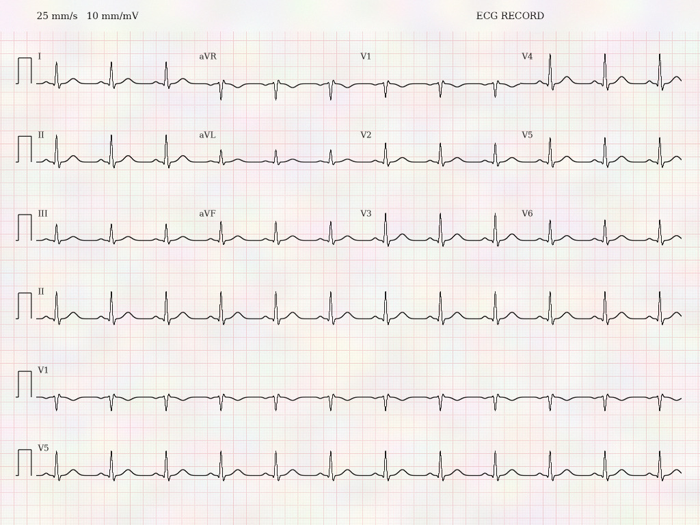

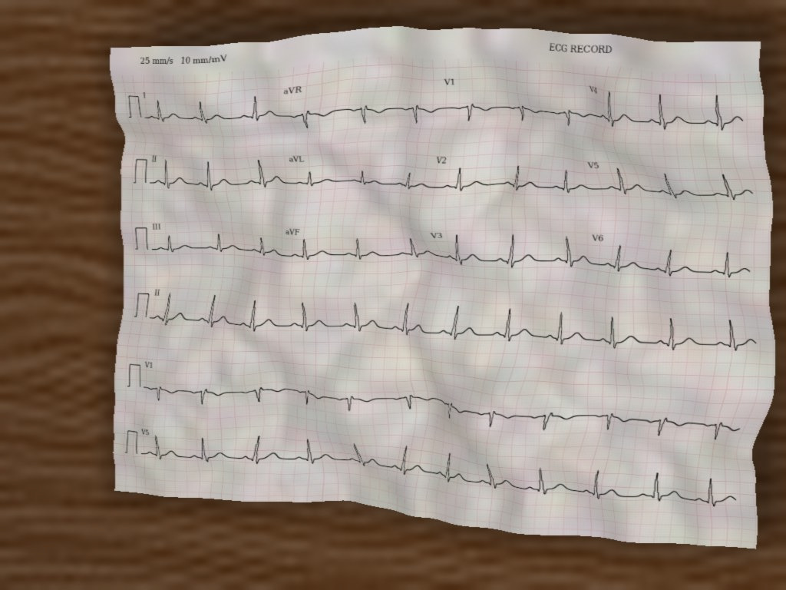

## Image-space targets

Targets describe geometric trace coverage in the observed image. Noise, JPEG artifacts, defocus and motion blur affect RGB. They do not corrupt the reference masks. Visibility removes explicitly hidden pixels when requested.

The source signal is retained as `RenderBatch.reference`. It contains the full input, including portions that may not be printed or visible. For waveform recovery, construct a loss over the appropriate observed time windows. Do not treat every source sample as recoverable from every layout.

## Gradients

Rendering runs under `torch.no_grad()`. Gradients train the image model. They do not flow from an image loss back to the source signal or to rendering parameters. This is a data transformation module, not an inverse solver.


# Layouts & calibration

Layout names count **rows × columns**. Thus `12x1` prints twelve full-duration rows, while `6x2` prints six rows with two lead windows each. `+r1`, `+r2` and `+r3` add full-duration rhythm strips.

## Pick a layout

```python
from ecg_gpu import ECGImageLayer, Choice

render = ECGImageLayer(parameters={
    "layout": Choice(["3x4", "3x4+r3", "6x2", "12x1"]),
    "rhythm_leads": ["II", "V1", "V5"],
})
```

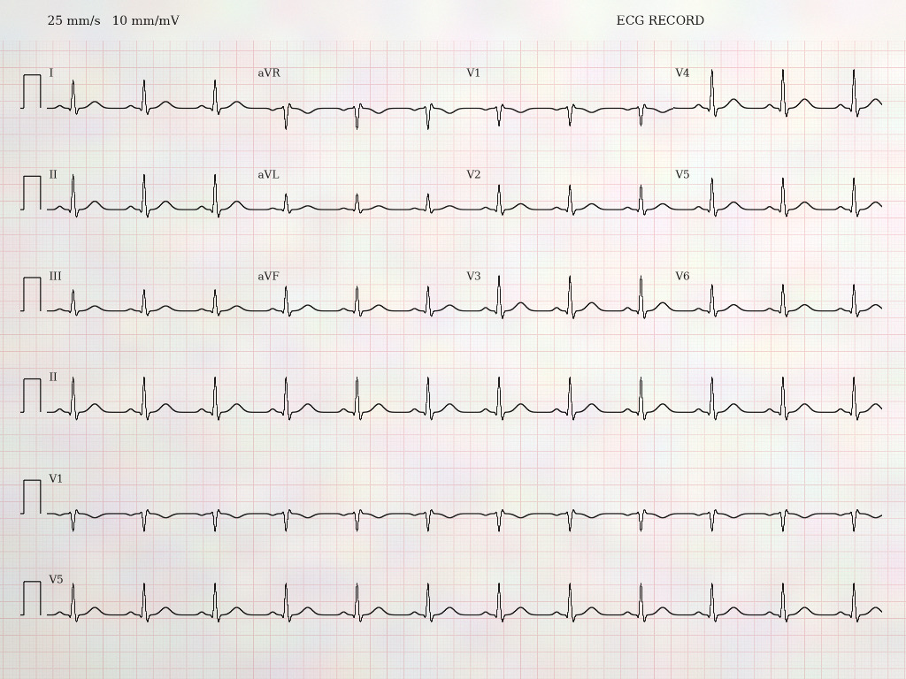

The standard library has 30 layouts. Inspect all of them in the [gallery](docs/gallery.html?category=Layouts).

See the generated API/layout reference for the full table.

## Sequential and simultaneous windows

With `sequential=True`, each short-row column covers a successive part of the recording. With `sequential=False`, each column starts at time zero. Rhythm strips span the full printed duration in both modes.

Check `metadata['start_s']`, `metadata['end_s']`, `metadata['lead_id']` and `metadata['active']` when supervising waveform recovery. A repeated lead can occur in several printed slots.

## Cabrera ordering

Cabrera layouts print `-aVR`. The output channel retains canonical aVR identity, and `instance_amplitude_sign` is `-1` for the inverted printed occurrence. The source waveform remains in standard lead order.

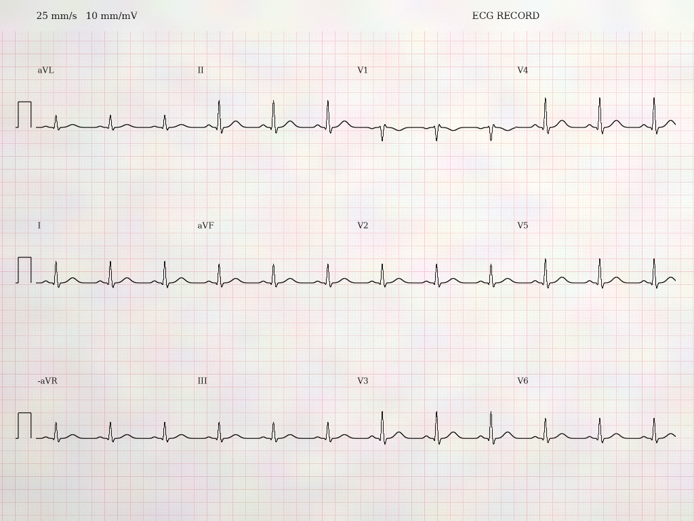

## Speed, gain and pulses

| Parameter | Index 0 | Index 1 | Index 2 |
| --- | --- | --- | --- |
| `speed_index` | 12.5 mm/s | 25 mm/s | 50 mm/s |
| `gain_index` | 5 mm/mV | 10 mm/mV | 20 mm/mV |

```python
render = ECGImageLayer(parameters={
    "speed_index": 1, "gain_index": 1, "pulse_present": 1.0,
})
```

`pulse_present` controls the 1 mV, 0.2 s calibration mark. Headers and labels can be hidden independently. For classification targets, unknown units are represented when explicit unit-text support is unavailable. This support test measures geometry, not OCR readability.

Long and dense arrangements need an appropriate aspect ratio. Use a tall page for `12x1` and a wide page for `1x12`. The layout does not automatically increase image resolution.


# Paper, tables & lighting

The procedural scene keeps geometry, normals, illumination and visibility together. A paper deformation changes both the photographed trace and its target mask.

## Eight paper surfaces

`flat`, `curl`, `fold`, `accordion`, `crumpled`, `wrinkled`, `rolled` and `corner` use a 2.5D height-field model. Select one surface or let `surface_mode='mixed'` sample the family.

```python
render = ECGImageLayer(parameters={
    "surface_mode": Choice(["flat", "fold", "crumpled"]),
    "surface_strength": Uniform(.2, .8),
    "relief_view": [.4, -.3],
})
```

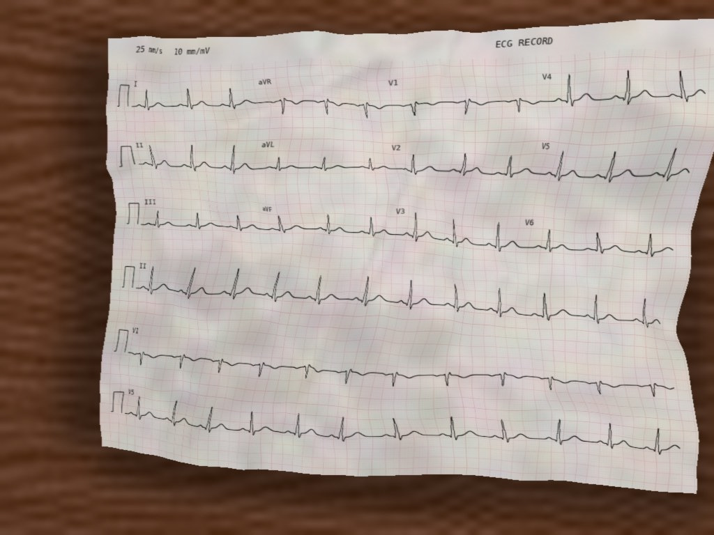

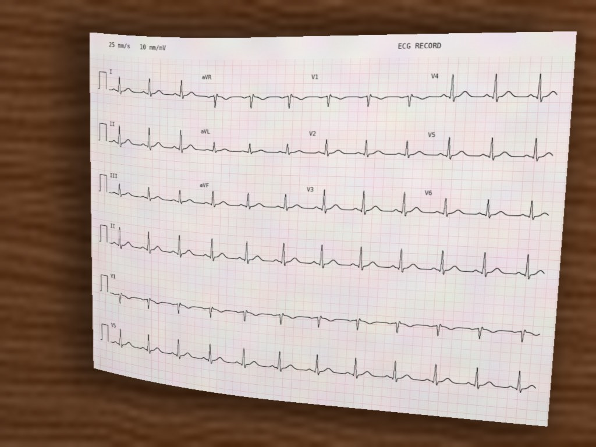

Browse the [paper gallery](docs/gallery.html?category=Paper) for the full set of surfaces and palettes. These are procedural approximations. They do not solve cloth dynamics or arbitrary sheet self-overlap.

## Tables and paper colors

Built-in table families are wood, marble, laminate, fabric, metal, clinical, plain and leather. Paper has eight palettes. Grid ink has five independent palettes.

```python
render = ECGImageLayer(parameters={
    "background_type": Choice(["wood", "marble", "clinical"]),
    "paper_palette": Choice([0, 1, 2, 4]),
    "palette": 0,                     # red grid
})
```

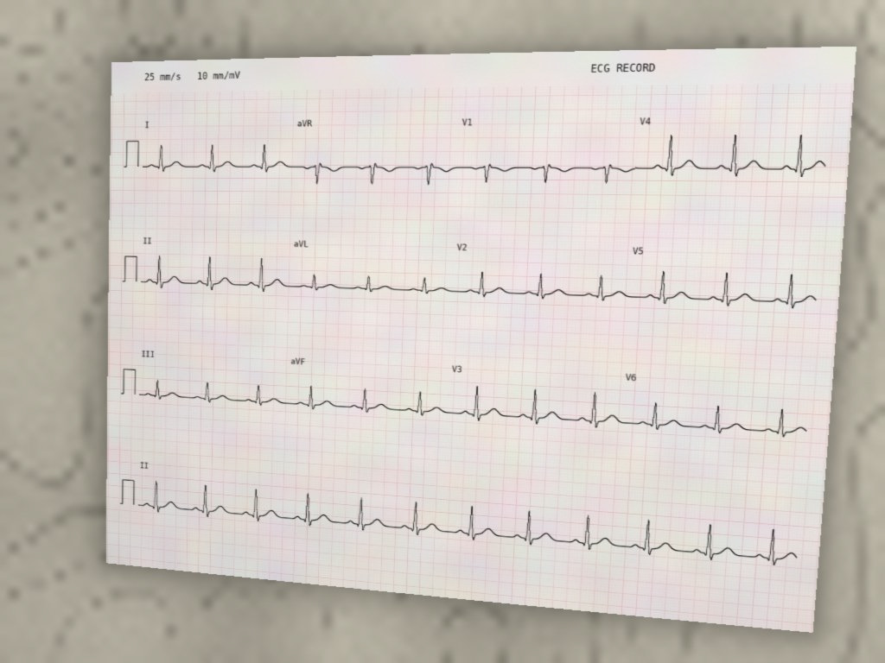

## Lighting and shadows

Three colored lights, ambient illumination, diffuse/specular shading, a flash term and approximate ambient occlusion affect the paper. The scene also supports sampled height-field shadows and paper cast/contact shadows.

Foreground shadow families are `none`, `edge`, `phone`, `hand`, `blinds`, `window` and `ellipse`. They are analytic silhouettes. They do not contain full 3D hand or phone geometry.

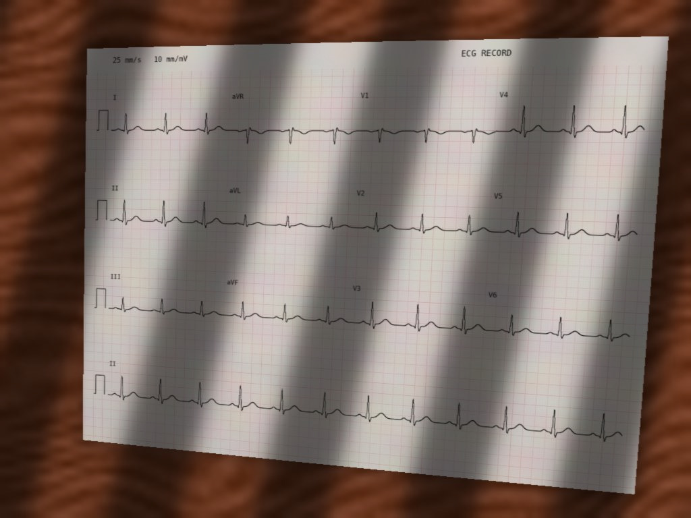

```python
render = ECGImageLayer(parameters={
    "object_shadow": "blinds",
    "object_shadow_strength": .5,
    "ambient_light": .65,
})
```

## Inspect the scene

```python
batch = render.render_batch(signals, stage="all", return_scene=True,
                            return_field=True, return_canonical=True)
normals = batch.scene["normals"]
height = batch.scene["height"]
visibility = batch.targets["valid"]
```

Scene maps are opt-in inspection outputs. Avoid retaining them when a training step only needs RGB or trace masks. [External document assets](docs/assets.html) can supply pre-rendered 3D visibility maps for shapes outside the procedural model.


# Capture & print artifacts

Printing, geometry and capture are independently configurable. Their default distributions are a starting point, then should be adapted to the images you expect to digitize.

## Geometry

Perspective, small rotations, quarter turns, zoom, translation, crops, radial lens distortion, curl and creases alter the sampling field. Targets use the same field.

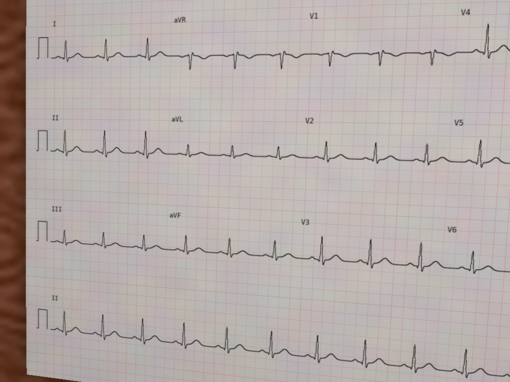

```python
render = ECGImageLayer(parameters={
    "angle": Uniform(-.2, .2),
    "quarter": Choice([0, 1, 2, 3]),
    "perspective_x": Uniform(-.2, .2),
    "perspective_y": Uniform(-.12, .12),
    "radial": Uniform(-.03, .03),
})
```

## Camera

| Control | Effect |
| --- | --- |
| `blur` | Defocus component of the point-spread function |
| `motion`, `motion_angle` | Directional motion blur |
| `read_noise`, `shot_noise` | Additive and intensity-dependent sensor noise |
| `exposure`, `white_balance`, `gamma` | Tone and channel response |
| `vignette` | Spatial attenuation near the frame edge |
| `jpeg_quality`, `jpeg_active` | 4:2:0 chroma and 8×8 DCT artifact simulation |

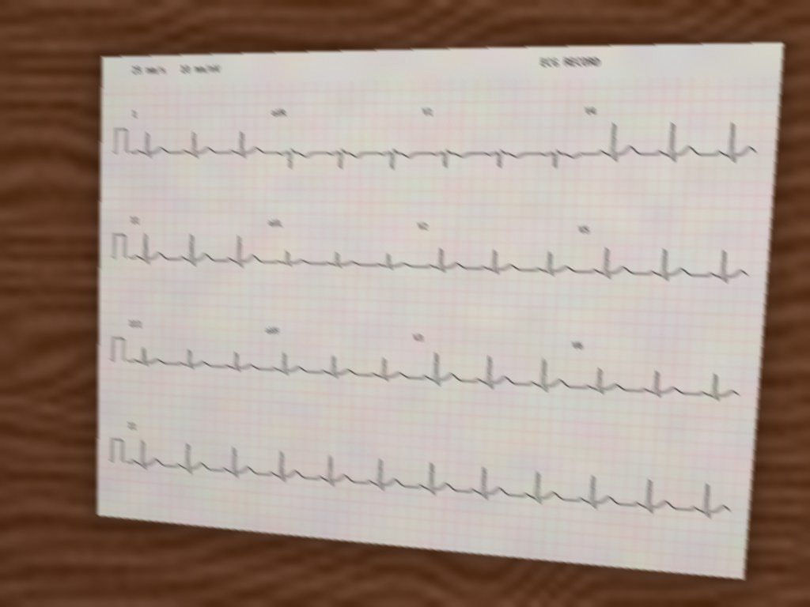

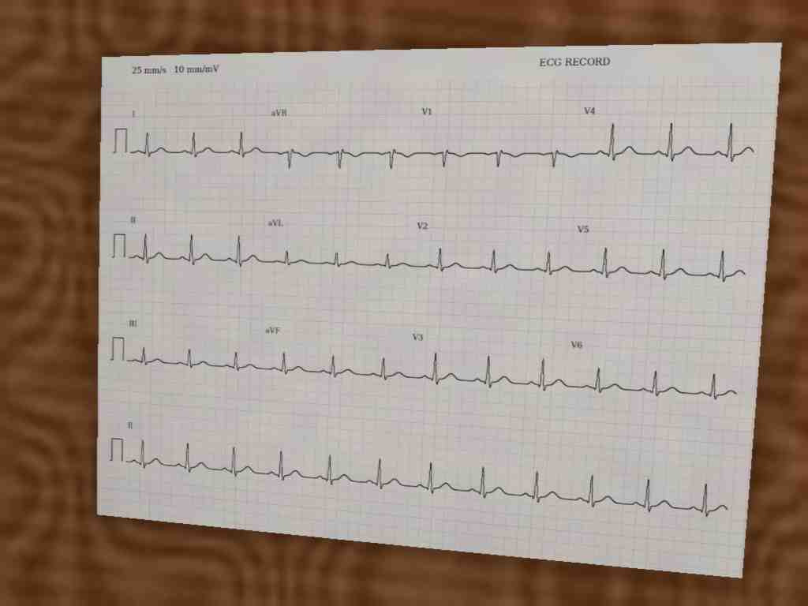

JPEG here is a decoded-artifact approximation implemented in Torch. It does not write an entropy-coded JPEG file. The CLI separately encodes the final image if you choose `.jpg`.

## Paper and print

Control ink width, color, density, thermal fading, scan bands, grid styles, grid phase, missing lead slots, label placement, fonts, unit headers, paper tint/age/noise, stains, coffee rings and reverse-side bleed.

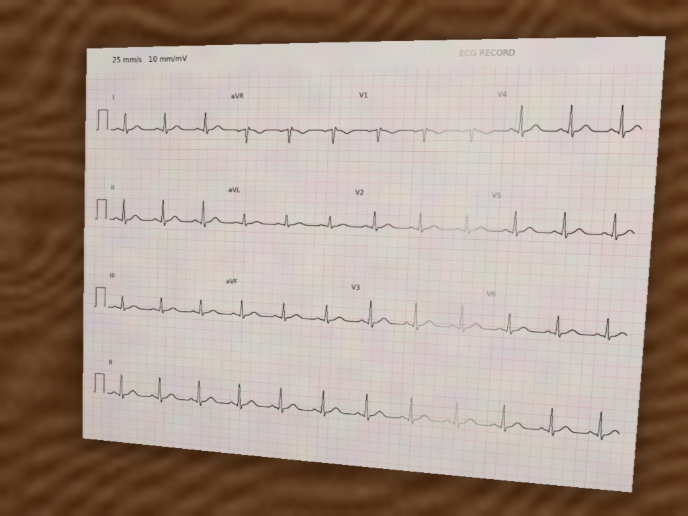

## Explicit occlusion

Tears remove part of the paper. Opaque rectangles, procedural pen strokes and rotated artifact text cover the printed page. The `valid` mask accounts for these explicit visibility changes.

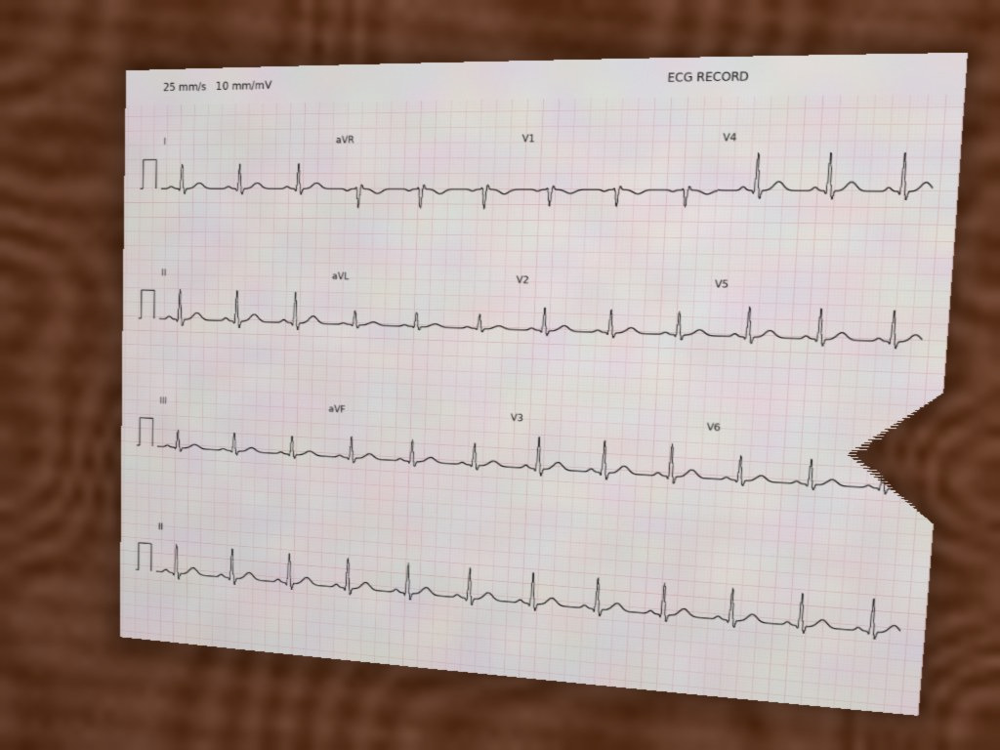

Shadowed or blurred pixels remain geometrically valid. Visibility does not mean the trace is readable. Keep a separate quality criterion if your application needs it.

`photo=False` produces a canonical page and disables the camera geometry, surface deformation and external document warps. It is useful for rectified training targets. It does not automatically remove every configured print artifact.


# Advanced supervision

Use `ECGSupervisionLayer` when your network needs an input image and aligned segmentation or detection targets. All requested outputs come from one render and remain on the input device.

## Request just what you need

```python
from ecg_gpu import ECGSupervisionLayer, SupervisionConfig, RenderConfig

synth = ECGSupervisionLayer(
    fs=500,
    config=RenderConfig(height=384, width=512),
    supervision=SupervisionConfig(
        outputs=("lead_masks", "bw", "wb", "lead_boxes", "instance_boxes"),
        binary=False, threshold=.05, visible_only=True,
    ),
).to(device)
batch = synth(signals)
```

The default requests only `lead_masks`. RGB and the visibility mask are always returned. Baseline targets, scene maps and instance masks are not generated unless required by the selected interface.

| Output | Shape | Meaning |
| --- | --- | --- |
| `image` | `[B,3,H,W]` | Photographed RGB, float32 in `[0,1]` |
| `valid` | `[B,1,H,W]` | Paper and explicit visibility support |
| `lead_masks` | `[B,C,H,W]` | Independent lead trace coverage, default C=12 |
| `lead_ids` | `[B,C]` | Canonical lead IDs in output channel order |
| `trace_mask` | `[B,1,H,W]` | Maximum coverage across selected lead channels |
| `bw` | `[B,1,H,W]` | `1 - trace_mask`, black traces on white |
| `wb` | `[B,1,H,W]` | `trace_mask`, white traces on black |
| `lead_boxes` | `[B,C,4]` | One envelope per selected lead, including repetitions |
| `lead_box_valid` | `[B,C]` | Whether that lead box contains any target pixels |
| `instance_masks` | `[B,15,H,W]` | Separate coverage for each printed occurrence |
| `instance_boxes` | `[B,15,4]` | One box for each printed slot |
| `instance_box_valid` | `[B,15]` | Whether that slot has visible target pixels |
| `instance_lead_ids` | `[B,15]` | Canonical identity of each printed slot |
| `instance_active` | `[B,15]` | Whether the layout/slot is enabled before capture |
| `instance_windows_s` | `[B,15,2]` | Printed source window `[start_s,end_s]` |
| `instance_amplitude_sign` | `[B,15]` | Printed polarity, including inverted aVR |

Instance metadata is returned when you request instance masks or boxes. Slots have fixed shapes for batching. Unused or invisible slots have false box-valid flags and boxes filled with `-1`.

## Two grayscale polarities

<div class="figure-pair"><figure>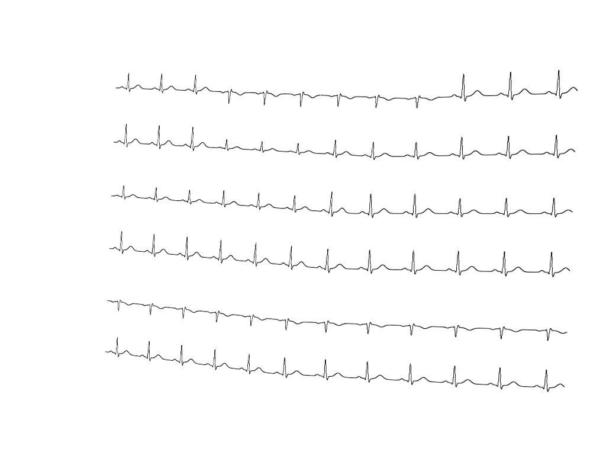<figcaption>BW: white background, black traces.</figcaption></figure><figure>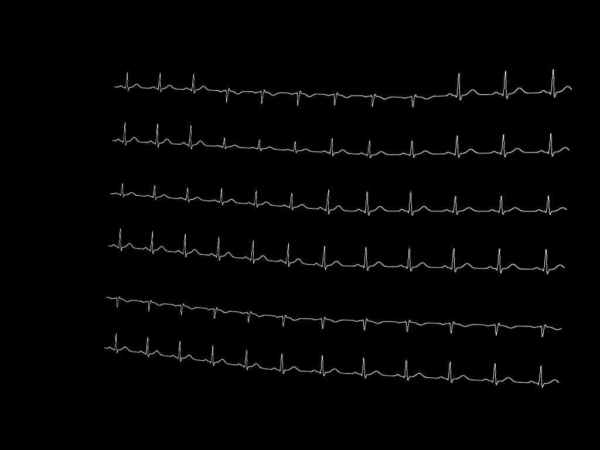<figcaption>WB: black background, white traces.</figcaption></figure></div>

These views contain only the chosen leads. Grid, labels, pulses, table texture and capture shadows are excluded. Soft coverage gives anti-aliased edges. Set `binary=True` for masks containing exactly zero and one.

## Independent channels

```python
supervision = SupervisionConfig(
    outputs=("lead_masks", "wb"),
    leads=("V6", "II", "V1"),       # choose and reorder channels
    binary=True,
    threshold=.3,
)
```

The default order is `I, II, III, aVR, aVL, aVF, V1, V2, V3, V4, V5, V6`. `leads` can select a subset or reorder channels. It also selects which leads contribute to BW/WB and the union mask. Instance outputs still describe all printed slots.

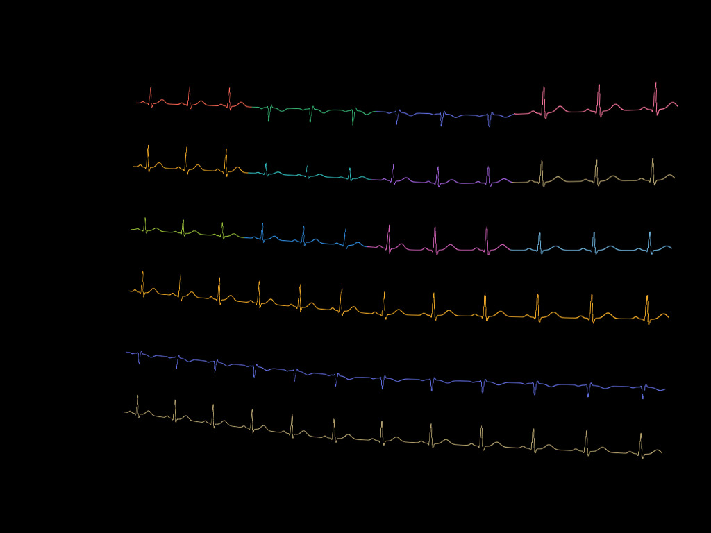

Colors visualize the masks. The actual target is a tensor of separate channels. At crossings, more than one channel may be positive. Use sigmoid/BCE or another multilabel objective. A mutually exclusive softmax target loses this information.

## Lead boxes and printed-instance boxes

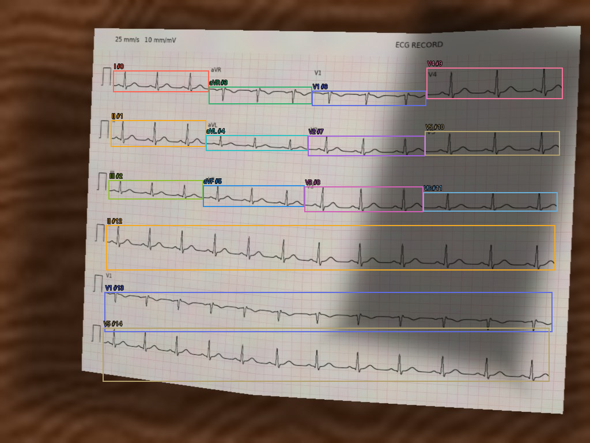

`lead_boxes` merge all visible occurrences of one canonical lead into one envelope. A long rhythm strip can make that envelope much larger than its short-row box. Use `instance_boxes` when training detection of individual printed traces.

Boxes use **integer pixel-edge xyxy coordinates**. The right and bottom edges are exclusive. For example, `[3,2,7,5]` covers columns 3–6 and rows 2–4. Box extraction uses pixels whose coverage is `> threshold`. The default threshold is `.05` so thin anti-aliased edges can contribute. Increase it if your target definition requires stronger coverage.

## Visibility and camera degradation

`visible_only=True` excludes torn paper, out-of-frame content and explicit opaque occlusion. `valid` can contain soft visibility values. It does not measure OCR readability, contrast or recovery confidence.

`visible_only=False` retains projected traces behind explicit occluders where the projection exists. Out-of-frame pixels still do not exist in an image-space target. This option can support amodal objectives, but it does not make invisible signal segments observable.

Noise, blur and JPEG degradation affect RGB, while target masks remain geometric. They are a clean target under the same capture geometry, not a thresholded copy of the noisy RGB.

## Reuse a richer render

```python
rendered = synth.render_batch(
    signals, stage="all", return_scene=True, return_instances=True,
    return_baselines=False, return_instance_boxes=False,
)
batch = synth.supervise(rendered)       # no second render
```

This lets you retain scene maps or provenance while using the same advanced target format. Match the requested instance outputs by rendering with `return_instances=True`.

## Export targets

```bash
ecg-render --input signal.npz --output ecg.png \
  --targets-dir targets \
  --targets lead_masks,bw,wb,lead_boxes,instance_masks,instance_boxes \
  --binary-targets --target-threshold 0.3
```

`targets.npz` preserves tensor arrays. `boxes.json` includes channel names and the coordinate convention. BW/WB PNGs are lossless grayscale exports. Add `--target-leads II,V1,V5` to choose channel order, or `--projected-targets` for targets behind explicit occluders.

Inside training, use tensors directly. File export, NumPy conversion and JSON serialization belong outside the hot path.


# Custom assets & layouts

Extend the generator at construction time. Banks are registered as module buffers, hashed for provenance, then used on-device during rendering.

## Custom layout

```python
from ecg_gpu import ECGRenderer, LayoutSpec, RenderConfig

layout = LayoutSpec(
    name="focused",
    rows=(("I", "II", "III"), ("V1", "V2"), ("V3", "V4", "V5", "V6")),
    rhythm=("II", "V1"),
)
renderer = ECGRenderer(RenderConfig(), layouts=[layout])
```

Rows can have different column counts. Short rows require unique standard leads. Rhythm strips can repeat leads, up to three strips. `-aVR` prints inverted aVR with canonical identity metadata.

## Photo and texture banks

```python
# Supply authorized RGB textures with values in [0,1].
paper_bank = torch.rand(4, 3, 128, 128)
table_bank = torch.rand(4, 3, 128, 128)
renderer = ECGRenderer(
    paper_textures=paper_bank,
    backgrounds=table_bank,
)
```

These random tensors only illustrate the bank format. In an experiment, use authorized texture images without patient information. Load and resize the bank before training. Large banks consume device memory after `.to(device)`.

## Fonts and annotations

```python
renderer = ECGRenderer(
    fonts=["/path/to/authorized-font.ttf"],
    artifact_texts=("COPY", "ARCHIVE", "TEST ECG"),
)
```

Glyph rasterization happens once during construction with Pillow. The generated atlas becomes a device buffer. Default annotations are printed text and procedural scribbles. Handwriting styles require a suitable supplied font or a richer custom augmentation.

## Externally rendered document geometry

For fully 3D paper, self-overlap or offline path-traced shading, provide a bank of camera-consistent inverse maps. Every map must describe the same camera and paper coordinates.

| Asset | Shape | Meaning |
| --- | --- | --- |
| `inverse_field` | `[K,H,W,2]` | Output pixel → paper UV, normalized for `align_corners=False` |
| `mask` | `[K,1,H,W]` | Visible paper support in `[0,1]` |
| `normals` | `[K,3,H,W]` | Camera-frame normal vectors |
| `height` | `[K,1,H,W]` | Nonnegative relief in half-page-width units |
| `shading` | `[K,1,H,W]` | Optional nonnegative illumination multiplier |

```python
from ecg_gpu import DocumentAssets

assets = DocumentAssets.from_npz("authorized-paper-maps.npz")
renderer = ECGRenderer(document_assets=assets)
```

The NPZ requires `schema="ecg-document-assets-v1"`. Generate UV and visibility offline with your own geometry tool, then package them together. The library resamples their maps on-device. It does not run Blender, simulate cloth or generate a 3D mesh bank for you.

Normals must be nonzero on visible paper and are normalized at construction. Shapes, finite values, visibility range and nonnegative height/shading are validated. Do not include document text or patient information in these assets.


# Scope & limitations

This package generates ECG images and paired targets. It does not contain a trained clinical digitizer, diagnose ECGs or guarantee recovery from arbitrary images.

## Geometry and realism

| Feature | Implemented scope |
| --- | --- |
| Paper deformation | Procedural 2.5D height fields with fixed-iteration inversion |
| Self-overlap | Can be supplied through externally rendered visibility/UV banks |
| Cloth dynamics | Not implemented |
| Phone/hand shadows | Analytic silhouettes |
| Lighting | Approximate local shading and sampled shadows |
| JPEG | Torch artifact simulation, not a complete codec |
| Handwriting | Procedural pen marks and supplied font styles |
| Table textures | Procedural defaults, optional authorized image banks |
| Visibility | Geometric and explicit occluder support, not readability confidence |

## Signal information

Cropping, occlusion and finite layout windows can remove information. Heavy blur and low contrast can make present information unrecoverable. The source reference still contains its original samples, so waveform losses must respect what the task actually observes.

The raster preserves narrow extrema through an envelope. At low resolution, that envelope can combine several samples into one pixel column. It does not make a many-to-one raster mapping invertible.

## Evidence boundaries

The included figures and integration runs use artificial ECG waveforms. The recorded performance comparison was on CPU. CUDA throughput, real-photograph realism and clinical waveform reconstruction have not been demonstrated in this release.

There is no validated claim that this generator is the most realistic in the world or that a model trained with it exceeds a commercial digitizer. Those claims require a reproducible comparative evaluation.

## Engineering boundaries

The renderer has no gradients to signals or rendering parameters. Python-level orchestration and randomization remain outside the optional compiled raster blocks. Cross-version/device bitwise reproducibility is not guaranteed. File I/O and initialization use CPU outside the hot path.

Use the [profiling tools](docs/profiling.html) to identify your actual bottleneck, and the [validation guide](docs/validation.html) to design evidence for your application.

