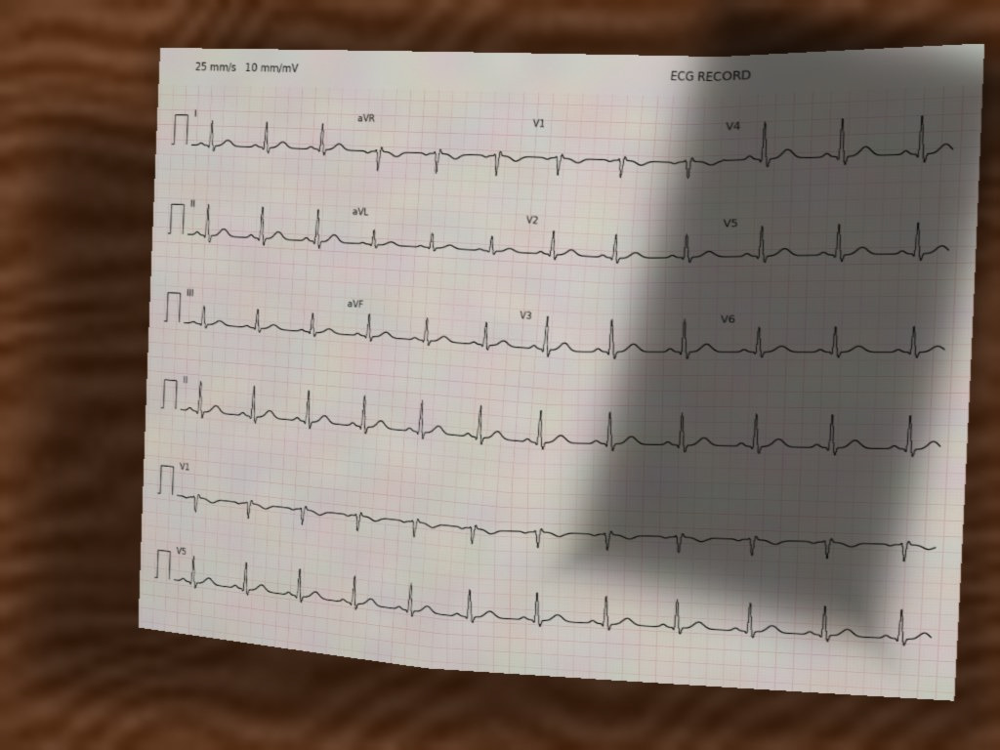
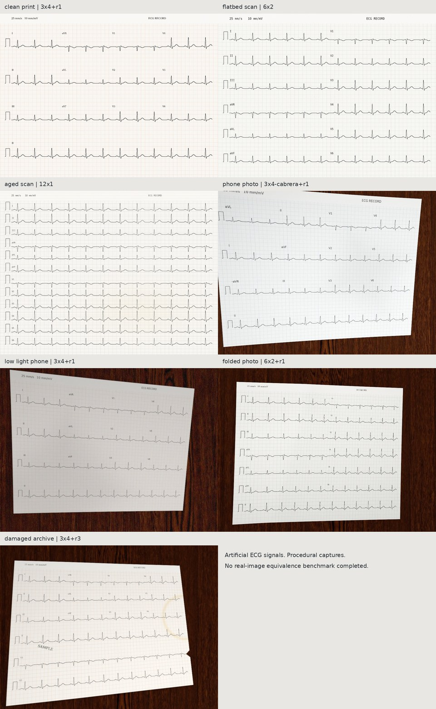
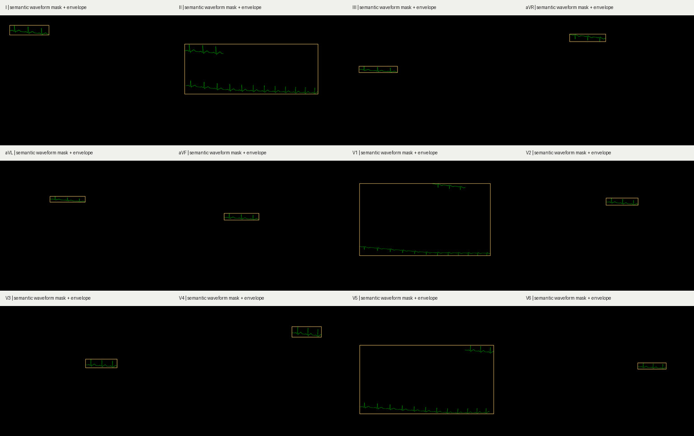
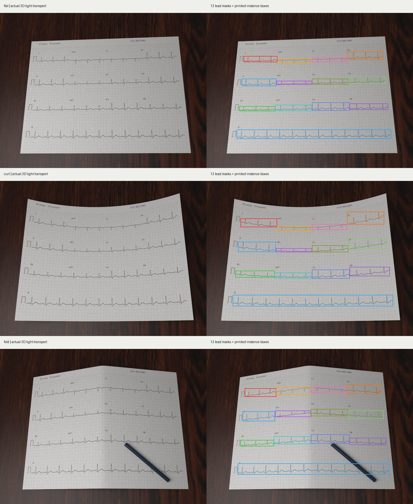

# ECG Torch Renderer

**Signals in. ECG photographs and aligned training targets out.**

A standalone PyTorch library for generating ECG prints and photographs inside
a training loop. Input `[B,12,T]` signals in mV, get RGB with optional independent
lead masks, black/white views and detection boxes. Rendering and target
generation stay on the signal device.

Both torch and offline rendering can export identified **5 mm grid
intersections**, their visible image coordinates and a point-only mask.
See [the grid-point guide](documentation/pages/grid-points.md) and
`python examples/grid_points.py --out build/grid-points --offline`.
Gaussian spread and disk radius are configurable without moving the fractional
centers. Optional x/y offset targets, a local subpixel decoder and a three-head
U-Net example support point localization training.

[Documentation](https://ecg-torch-renderer-docs.sageotter16.chatgpt.site) ·
[Guide source](documentation/pages/quickstart.md) · [Gallery recipes](docs/gallery.json) ·
[GPU Colab notebook](https://colab.research.google.com/github/fmenegui/ecg-torch-renderer/blob/main/notebooks/colab_gpu_profile.ipynb)



*Actual renderer output from artificial ECG waveforms. The guide includes 125
generated figures and their rendering recipes.*

## Install

Install the appropriate [PyTorch build](https://pytorch.org/get-started/locally/),
then install the package:

```bash
git clone https://github.com/fmenegui/ecg-torch-renderer.git
cd ecg-torch-renderer
python -m pip install -e .
```

Python ≥3.10, Torch ≥2.6, NumPy ≥1.24 and Pillow ≥10.1. Optional WFDB input:
`python -m pip install -e '.[wfdb]'`.

## Your first image

Version **0.9.1** corrects a template header collision found during enlarged
visual review. The regression covers 72 typography combinations. See the
[header correction](research/TEMPLATE_HEADER_FIX.md).

Version **0.9.0** adds physical document templates, thermal printing, scaled
paper-scan imports, depth-dependent optics, an emissive RGB display model and
coupled liquid/storage history. Offline sheets support compliant relaxation,
finite thickness, cut lips, fibers and reusable primary-ray geometry banks.
See [physical realism](documentation/pages/realism.md) and
[architecture and quality gates](documentation/pages/architecture.md).
Measured presets and external photographic equivalence remain unverified.

```python
import torch
from ecg_gpu import ECGImageLayer, RenderConfig, Choice, Uniform
from ecg_gpu.demo import demo_signals

device = torch.device("cuda" if torch.cuda.is_available() else "cpu")
values, fs, _ = demo_signals(fs=500, duration=10)
signals = torch.tensor(values, device=device)[None]   # [1,12,T], mV
render = ECGImageLayer(
    fs=fs,
    config=RenderConfig(height=384, width=512),
    parameters={"layout": Choice(["3x4+r3", "6x2", "12x1"]),
                "angle": Uniform(-.12, .12)},
).to(device)
rgb = render(signals)                              # [1,3,384,512]
```

Fixed values and distributions become registered buffers. Training calls
randomize the capture. `.eval()` repeats the base seed. The layer has no
trainable parameters. Gradients train the downstream image network.

## Input and U-Net target in one forward

```python
from ecg_gpu import ECGSupervisionLayer, SupervisionConfig
from torch.nn import functional as F

synth = ECGSupervisionLayer(
    fs=fs,
    config=RenderConfig(height=384, width=512),
    supervision=SupervisionConfig(
        outputs=("lead_masks", "bw", "wb", "lead_boxes", "instance_boxes")
    ),
).to(device)
batch = synth(signals)                             # one capture
logits = unet(batch["image"])                       # [B,12,H,W]
loss_map = F.binary_cross_entropy_with_logits(
    logits, batch["lead_masks"], reduction="none"
)
loss = (loss_map * batch["valid"]).sum() / (
    batch["valid"].sum() * logits.shape[1]
).clamp_min(1)
loss.backward()
```

| Optional output | Contract |
| --- | --- |
| `lead_masks` | Independent `[B,C,H,W]` channels, default C=12 |
| `bw` | White background with black traces only |
| `wb` | Black background with white traces only |
| `lead_boxes` | `[B,C,4]`, per-lead envelopes including repeated strips |
| `instance_masks` | `[B,15,H,W]`, separate printed occurrences |
| `instance_boxes` | `[B,15,4]`, separate printed-occurrence boxes |

RGB and `valid` are always returned. Choose soft/binary targets and reorder or
select lead channels. Boxes use xyxy pixel edges with exclusive right/bottom
bounds. Empty boxes are `-1` with false validity flags. Default targets exclude
explicitly occluded pixels. Auxiliary traces exclude grid, labels and pulses.
Use sigmoid/BCE channels to preserve independent lead crossings.

Run the [complete small U-Net example](examples/segmentation.py):

```bash
python examples/segmentation.py --steps 3
python examples/segmentation.py --device cuda --compile-raster
```

## Explore the generator

| Area | Built-in controls |
| --- | --- |
| Layouts | 30 layouts, 0–3 rhythm strips, long rows, Cabrera and custom uneven rows |
| Calibration | 12.5/25/50 mm/s, 5/10/20 mm/mV, shared scale and pulses |
| Paper | 8 palettes, grid styles/colors, print fading, stains, bleed and texture banks |
| Geometry | Perspective, rotation, crop, radial distortion and 8 surface families |
| Scenes | 8 table-material families, colored lighting and procedural shadows |
| Capture | Defocus/motion, exposure, white balance, sensor noise and JPEG simulation |
| Occlusion | Tears, opaque patches, pen marks and rotated artifact text |
| Extension | Fonts, photo banks and external inverse-UV/3D visibility maps |

These features include procedural approximations. See [METHODOLOGY.md](METHODOLOGY.md)
and the [scope guide](documentation/pages/limitations.md).

## Reproducible adverse captures

`angle` is an absolute rotation in radians. Overriding only `quarter` retains
the sampled small angular jitter and recomposes that rotation. Overriding only
`angle` derives its nearest quarter-turn class. Contradictory explicit pairs
are rejected. `parameters['photo']=0` disables photographic geometry per record,
while `sensor_active` controls optics independently. `ECGImageLayer(photo=False)`
selects the final rectified document path for every forward call.

Large custom type must fit `RenderConfig(max_font_size=...)`. The default bound
scales with image width and covers all automatically sampled fonts. Font atlases
and glyph patches are sized at construction rather than silently clipping ink.

For a homogeneous capture, static camera settings avoid computing unused paths:

```python
config = RenderConfig(camera_mode="direct", jpeg_enabled=False)
layer = ECGImageLayer(config=config, photo=False, stream_id=1)
```

`direct` requires `sensor_active=0`, `sensor` requires `sensor_active=1`, and
`full` accepts heterogeneous sensor controls. Disabling JPEG requires
`jpeg_active=0`. Sampled defaults follow these static settings. Scenario recipes
select the appropriate specialization automatically.

Version **0.8.0** adds irregular crease networks, material-coordinate tears,
open cuts, holes and missing corners, plus distinct oxidation, liquid deposits,
foxing, fibers and thermal-coating damage. Sixteen capture recipes keep masks,
boxes and source signals aligned. Optional 3D capture supports irregular sheets
and physically absent substrate. See the [third review](research/ROUND3_REPORT.md).

```bash
python examples/capture_scenarios.py --out build/scenarios
python examples/pathtraced_capture.py --adverse --out build/physical --spp 192
python examples/export_yolo.py --scenario missing_fragments --out build/yolo
```

The richer material and damage paths cost more than the previous approximations.
`RenderConfig(damage_detail="edge")` selects a cheaper first-tear-only path.
Use `"rich"` for holes, slits, corners and multiple tears.

Version **0.7.0** adds a second capture backend: optional offline Mitsuba 3D
light transport with ray-aligned masks and boxes. The torch training renderer
now shades and resamples in linear light, projects shadows from caster height,
and attaches paper annotations to the same material coordinates as the ECG.
See the [second independent review](research/ROUND2_REPORT.md).

Version **0.6.0** adds seven coherent scenarios: clean print, flatbed scan,
aged scan, phone photograph, low-light phone photograph, folded paper and
damaged archive. All recipes keep twelve leads active. Tears and annotations
can hide content, reflected in the usual visibility targets.

```python
from ecg_gpu import capture_scenario, ECGImageLayer

config, parameters = capture_scenario("low_light_phone", severity=.8)
parameters["layout"] = "3x4+r1"
layer = ECGImageLayer(fs=500, config=config, parameters=parameters, seed=42)
rgb = layer(signals)
```

Export an auditable gallery with entirely artificial signals:

```bash
python examples/capture_scenarios.py --out build/scenarios
```



The camera now integrates a finite shutter path and adds independent sensor
noise variances. Resolution metadata describes the canonical page before
perspective, not the source sampling rate. See the [engineering review](research/SWARM_REPORT.md)
for test results, measured target-postprocessing performance and outstanding
real-image validation. These scenarios are engineering stress recipes rather
than calibrated models of named scanner or camera hardware.

## CLI export

```bash
ecg-render --input signal.npz --output ecg.png \
  --layout 3x4+r3 --targets-dir targets --metadata capture.json
```

NPY/NPZ and optional WFDB input are supported. The CLI normalizes mV/uV/V units,
reorders declared leads and writes PNG/JPEG. Advanced exports include
`targets.npz`, `boxes.json` and lossless BW/WB PNGs. File I/O and encoding happen
outside training.

## Train U-Net and YOLO

All twelve independent waveform masks are available as `lead_masks[B,12,H,W]`.
`lead_boxes[B,12,4]` encloses every visible occurrence of the same lead.
For detection, use `instance_boxes[B,15,4]` instead: a repeated long II strip
is another object with class II. Padding, absent and fully hidden instances
must be excluded using the returned validity flags.

```python
from ecg_gpu import ECGSupervisionLayer, SupervisionConfig, detection_targets

synth = ECGSupervisionLayer(
    supervision=SupervisionConfig(outputs=("lead_masks", "lead_boxes", "instance_boxes"))
).to(signals.device)
batch = synth(signals)
yolo = detection_targets(batch)  # batch_idx, cls (0..11), normalized xywh
masks = batch["lead_masks"]      # independent sigmoid channels for U-Net
```

Instance outputs also provide `instance_visible_fraction[B,15]`, the fraction
of canonical waveform ink surviving geometric visibility and crop. It uses
inverse-Jacobian area quadrature, not box sparsity or optical readability:

```python
yolo = detection_targets(batch, min_visible_fraction=.25)
```

The offline exporter accepts the same `min_visible_fraction`. Fractions near
subpixel damage boundaries are resolution-dependent. They do not estimate how
much signal can be recovered after blur, fading or sensor noise.

These boxes enclose waveform ink. They are not full layout-cell boxes and do
not include labels or calibration pulses. `instance_masks` also preserves
separate masks for repeated occurrences. Overlapping leads retain independent
ownership, so use sigmoid/BCE rather than exclusive softmax classes.

```bash
python examples/inspect_supervision.py --out build/masks
python examples/export_yolo.py --out build/yolo --groups 4 --views 2
python examples/train_yolo.py --data build/yolo/dataset.yaml --epochs 1
```

YOLO is optional. Install matched Torch/torchvision builds, then
`pip install -e '.[yolo]'`. The example creates an architecture from YAML and
trains without pretrained weights. Export writes PNGs, normalized labels,
`dataset.yaml` and a provenance manifest. Group actual recordings by patient
before exporting. The tiny artificial example verifies integration only.
Disconnected waveform masks are not exported as misleading YOLO polygons.



## Optional 3D captures

```bash
pip install -e '.[pathtrace]'
python examples/pathtraced_capture.py --out build/pathtraced --spp 128
```

This offline route uses a developable 3D mesh, diffuse light transport,
area-light shadows, measured CC0 tabletop texture and explicit occlusion.
Each geometric target samples the same camera's actual visible paper rays.
The unprinted backside receives no front-trace labels. Full camera/light
configuration and source/content hashes accompany PNGs, NPZ targets and YOLO
detection labels. Supply `--input recording.npz --fs 500` for your own signal.
The torch training path remains independent of Mitsuba.



This is prescribed paper geometry, not a cloth dynamics solver. The included
wood texture is [attributed separately](assets/ATTRIBUTION.md). Neither backend
has established photographic indistinguishability or clinical generalization.

## Detailed GPU profiling

```bash
ecg-renderer-profile --device cuda --preset balanced --batch-size 4 \
  --compile-raster --compile-scene --steps 30 --warmup 5 --profile-steps 3 \
  --out profile-renderer
```

Add `--train-step` for the small CNN workload, or use `profile_layer` with your
own U-Net training step. Reports include median/p90, images/s, CUDA events,
allocator peaks, operator/kernel CSVs, a compressed trace and ZIP. The first
compiled call is separate. Instrumented passes are excluded from warm timing.

Version **0.5.0** integrates material-coordinate bends and finite creases, coherent
matte lighting, smoother sheet edges, less repetitive table textures and a
coarse-to-fine inverse solve. `compile_scene=True` optionally fuses deterministic
geometry, lighting and Newton updates. The source signal and shared target field
remain unchanged in purpose. See [paper controls](documentation/pages/scenes.md).

The uploaded **0.4.0 Tesla T4** run measured approximately **81 images/s at
512×384** and **31 images/s at 1024×768**, batch 4, compiled raster. These historical
numbers do not measure the new paper model. Current CPU results and a fresh GPU
notebook are included in [PERFORMANCE.md](PERFORMANCE.md). The original Colab run
had one stored-fixture failure, which remains recorded with its diagnostic limit.

## Documentation and checks

For independent workers or distributed ranks, assign distinct `stream_id`
values. The default zero preserves a single reproducible stream and does not
automatically inspect process state. For offline captures stable across worker
assignment and input ordering, derive seeds before rendering:

```python
from ecg_gpu import render_seed

seed = render_seed(1973, "recording-17", view_id=2)
layer = ECGImageLayer(seed=seed, randomize=False)
```

Checkpoint state includes the stream and static photo mode. The renderer's
signal reference is unchanged by these controls. The optional offline backend
accepts `PathTraceConfig(variant="cuda_ad_rgb")` when supported by the installed
Mitsuba build and hardware. CPU remains the default. This release does not
claim a measured CUDA speedup or a real-image accuracy improvement.

```bash
python -m unittest discover -s tests -v
npm install --prefix documentation
python documentation/build.py
python documentation/validate.py
python -m http.server 8000 --directory docs
```

The English static guide has local search, code copying, responsive navigation,
light/dark themes, a generated API reference and a filterable gallery. The
hosted Site currently requires the owner's account. All guide sources,
generated pages and images are public here and can be hosted from `docs/`.

This is an image/target generator. It does not include a trained clinical
digitizer or demonstrate superiority to a commercial system. Examples use
artificial signals. [Contributing](CONTRIBUTING.md) · [Changelog](CHANGELOG.md) · MIT.


