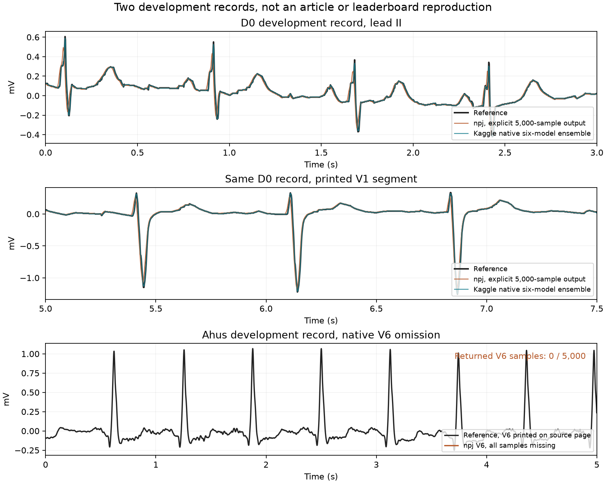

# Revisão das execuções em GPU, 30 de outubro de 2026

A credencial `RUNPOD_API` funciona no GitHub Actions. Os pilotos usaram uma L4
real no Runpod, com CUDA 12.8 e Torch 2.7.0. Não há reprodução concluída dos
resultados principais dos artigos ou do leaderboard.

## Evidência executada

- npj: inferência com os dois pesos publicados, um fixture original e sete
  imagens públicas de desenvolvimento. Ambos os modelos também completaram
  treinos reduzidos em GPU, com duas amostras de treino e uma de validação.
- Kaggle: notebook original da solução em segundo lugar, com os seis modelos
  de waveform e os dois modelos de pré-processamento. Um registro público D0
  produziu waveform e CSV de submissão em GPU, com carregamento estrito dos pesos.
- Powerful Medical: os controles analíticos da reconstrução independente foram
  executados. Não foi treinado um Dotter equivalente ao comercial. A base
  original de anotações e seus pesos não foram obtidos.

## Comparação comum no único registro D0

| Método | Cobertura numérica do suporte impresso | Média dos 12 SNRs alinhados | Média dos 12 RMSEs alinhados |
| --- | ---: | ---: | ---: |
| npj com saída explicitamente configurada para 5.000 amostras | 99,40% | 17,049 dB | 0,01763 mV |
| Notebook Kaggle com seis modelos | 100% | 29,565 dB | 0,00398 mV |

Cada diagnóstico permite deslocamento de até 100 ms, centraliza DC e não ajusta
amplitude. O suporte mínimo após alinhamento é 90%. Todos os 12 diagnósticos
estão definidos neste caso. Essa média em dB não é o scorer oficial do Kaggle,
nem o protocolo nativo do artigo. Este ECG de desenvolvimento pode ter sido
usado no treinamento original do Kaggle. Não constitui avaliação externa ou
ranking de robustez. As saídas brutas da figura não foram alinhadas ao sinal real.

## Limitações que os pilotos tornaram observáveis

O preset George Moody original retorna 10.000 amostras. O registro público D0
contém 5.000 amostras a 500 Hz. A primeira avaliação conservou a incompatibilidade.
A segunda usou um parâmetro explícito de metadados, sem reamostragem implícita.

As seis imagens Ahus representam um único ECG, duas páginas e três variantes.
A cobertura numérica média das páginas dos membros foi 99,95%. Nas precordiais,
foi 77,76%. V6 ficou inteiramente ausente nas três saídas, embora esteja visível
na página original p00 inspecionada e também na imagem alinhada. Isso é um caso
concreto para decompor o erro, não uma estimativa de falha da coorte de 266 ECGs.
Os códigos de aquisição foram conservados sem atribuir nomes de dispositivos
antes de verificar o crosswalk de metadados.

O primeiro replay Kaggle falhou por faltar um arquivo NPY de referência usado
pelo helper original. O arquivo foi recuperado da versão fixada dos assets,
verificado e incluído no manifesto. A execução anterior permanece registrada.

O controle sintético de capacidade com batch 12 e patches 1024 por 1024 falhou
na L4 de 24 GB com falta de memória. O lote não foi reduzido silenciosamente.
O teste de roundtrip do estado RNG de CUDA passou. Isso não demonstra paridade
completa de retomada de treinamento ou com a execução histórica dos autores.

## Treinamento completo e fronteira das conclusões

O workflow separado usa a versão original dos 72 shards, aproximadamente 75 GB,
e preserva o perfil de 45 épocas da tabela do artigo e o perfil público de 30
épocas do reconhecedor de nomes. Antes do download, uma GPU com pelo menos
48 GB precisa passar o controle do lote original. São no máximo cinco etapas
de cinco horas, uma GPU por vez, até US$ 0,99 por hora e US$ 24,75 de GPU no total.
O volume durável tem 220 GB. Armazenamento e arredondamento são adicionais.

Checkpoints são retomados em fronteiras de épocas concluídas. Um erro de execução
interrompe novas alocações das etapas seguintes. Se o limite chegar antes do fim,
o volume é conservado para recuperação e continua faturável. A GPU de cada etapa
é excluída e sua ausência verificada. Um volume com treino concluído só é removido
após upload do artefato de checkpoints. O banco histórico de fontes não está
publicado. As fontes observadas ficam identificadas por hash.

Completar os perfis de treino não basta para reproduzir uma pontuação. Ainda são
necessários o mapeamento exato das coortes, o scorer nativo e a retenção das falhas.
O gold privado do Kaggle não foi obtido. Não há evidência de superioridade ou
benefício clínico da nossa futura biblioteca nesta etapa.

## Rastreabilidade

- [Primeiro piloto com treino reduzido e Ahus](https://github.com/fmenegui/ecg-torch-renderer/actions/runs/41064387591)
- [Replay completo Kaggle e controle de capacidade](https://github.com/fmenegui/ecg-torch-renderer/actions/runs/41068471976)
- [Contexto e hashes do primeiro piloto](runpod-gpu-pilot-2026-10-30/context.json)
- [Contexto e hashes do replay](runpod-native-replay-2026-10-30/context.json)

Os arrays, imagens e checkpoints maiores estão nos artefatos das execuções.
Os recibos, configurações, avaliações e logs selecionados estão nesta pasta.
Os dois pilotos tiveram GPU e volume temporário excluídos com verificação externa.
