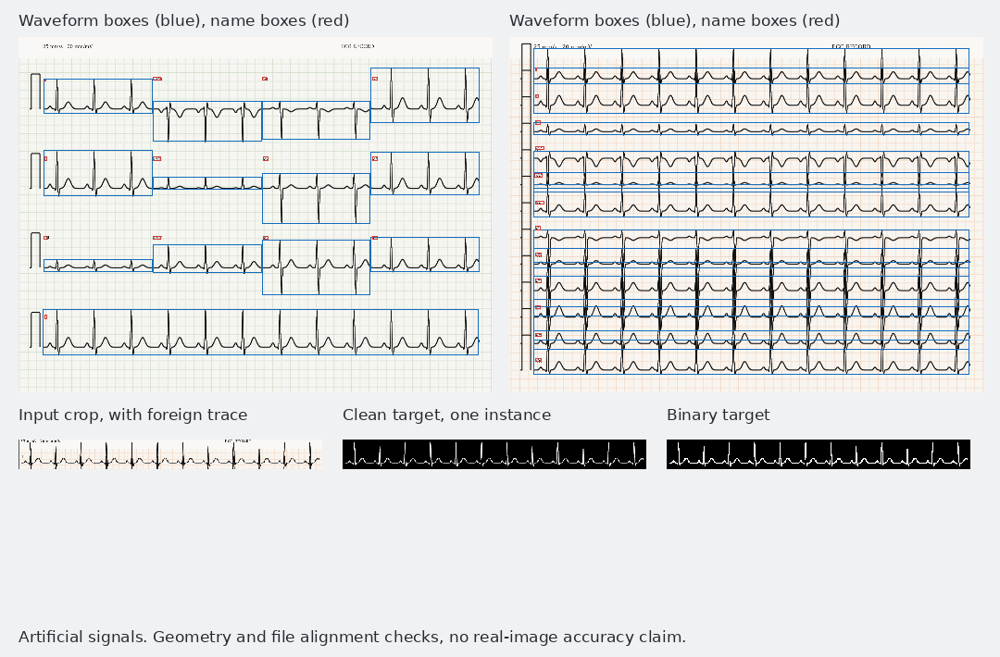

# Paired task datasets, v0.13.0

This change adds the missing task interfaces identified while comparing this
project with SynthECG. It does not establish an improvement in digitization
accuracy or replace the external real-image studies on the research branches.

## Added capabilities

| Capability | Implementation |
| --- | --- |
| Per-occurrence lead-name supervision | name_masks/name_boxes from one render, same geometry and visibility |
| Lead-name training targets | Canonical 12-class YOLO/torchvision adapter, repeated rhythm labels and Cabrera polarity |
| Paired digitization export | Encoded page, original NPZ/JSON signal, visibility, calibration and inverse field |
| Joint lead/name detection export | 13 classes, waveform region 0 and lead names 1..12 |
| Single-instance segmentation export | RGB, clean PNG mask, binary BMP, validity and time-series JSON |
| Overlap partitions | Foreign instance ink in each crop, with exact crossing counts separately |
| Cohort provenance | Patient-group train/validation/test split, normalized source and file hashes |
| Dataset generation | Local NPY/NPZ/WFDB manifest, configurable views/layout/capture/gain, bounded dense-target memory |

The source plan is checked before generation. Captures are streamed into
staging and published only when the complete plan succeeds. Missing,
duplicate or altered captures abort publication. Existing nonempty outputs
are preserved. Source/group identity still depends on correctly supplied
patient identifiers.

The original signal is never resampled to fit a crop. Crop JSON uses original
source indices and absolute times in the printed half-open interval. Canonical
and printed polarity are explicit. References can describe portions hidden by
damage or cropping and are not advertised as entirely observable targets.
Float16/32/64 reference values retain their source storage precision. bfloat16
uses its exact float32 representation. Source identity uses the existing
normalized float32 fingerprint contract, while file hashes cover exported data.

## Validation

- Sixteen new CPU contract tests pass, including unchanged RGB/old targets,
  repeated and inverted labels, no host reads in the training adapter,
  photographic field/visibility alignment, original units/time/precision,
  grouped partitions, exact crop files, source leakage and atomic streaming.
- Final local integration: 312 tests, 304 passes, six explicit CUDA skips and
  two errors caused exclusively by the unavailable original raster-v021.npz
  fixture in this partial checkout. The fixture was not regenerated or changed.
  Full-checkout GitHub CI remains the gate for those two raster regressions.
- Fatal-error lint across package/tests/examples and strict E/F lint on the
  changed task modules pass. Python compilation and whitespace checks pass.
- Sixteen adverse capture scenarios were exported at 512 by 384 and visually
  inspected. The existing RGB path remains opt-in compatible.
- The all-artificial integration dataset contains eight pages and 100 crops.
  At 512 by 384, gain 20 mm/mV, threshold .05 and four-pixel crop padding,
  94 crops contain foreign instance ink and six do not. These counts describe
  this artificial recipe, not a clinical distribution or segmentation score.



The image compares waveform boxes (blue), name boxes (red) and a crop with its
clean instance and binary targets. The foreground remains white in masks.
Geometric presence is separate from legibility under blur, fading and damage.

## Reproduce

```bash
python -m unittest discover -s tests -p test_paired_dataset.py -v
python -m unittest discover -s tests -v
python examples/export_paired_dataset.py --out build/paired-review --width 512 --height 384
python examples/capture_scenarios.py --out build/scenarios --width 512 --height 384
ecg-dataset --manifest sources.json --out build/paired --views 3
```

CUDA execution and performance were unavailable. No original SynthECG dataset
archive was downloaded or benchmarked. No new trained digitizer, clinical
measurement validation or superiority result is claimed. Dataset packaging
does not settle orientation, calibration or robust waveform recovery.

## Attribution

The task organization follows Rahimi, Karbasi and Vahabie, SynthECG,
[preprint 2025](https://arxiv.org/abs/2506.06315),
[journal article 2026](https://doi.org/10.4103/jmss.jmss_58_25), and
[repository](https://github.com/rezakarbasi/ecg-image-and-signal-dataset),
inspected at fa6998d26ce87a62dc921cde69ffc6f67a23ae2e.
This is an independent implementation using this project's renderer.
No upstream code, dataset or license terms are copied into the package.
