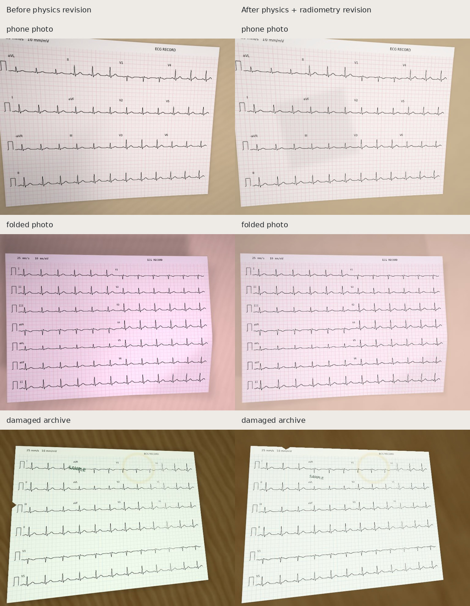

# Round 2 physical scene audit

Date: 2026-10-18. Baseline: `3360dd6a60d765771efbd5b0de9af2f2a9a223f8`.

The previous examples did look artificial. Passing the geometry tests did not
establish photographic equivalence. This revision addresses identifiable
physical and visual defects. It does not establish "100% realism".

## Defects found and corrections

| Observation or defect | Implemented correction | Evidence |
| --- | --- | --- |
| Repeating sine-wave wood covered every tabletop | Replaced periodic bands with restrained anisotropic stochastic grain. Other fallback materials no longer use regular sinusoidal stripes | Same-input visual comparison below |
| Random saturated blue, green and pink paper | Restricted default palette to neutral, lightly warm and archival paper. Explicit custom RGB banks remain supported | Palette inspection and rendered gallery |
| Three unrelated similarly powerful lights | Sample one dominant key, weaker room fill and overhead bounce with correlated warm/cool shifts | Parameter inspection |
| Shadow inverse sampling used height at the receiving background pixel | Forward projection uses each casting paper pixel's own height | Independent ray-plane intersection and unequal-height caster tests |
| Fixed dark contact halo remained attached to lifted paper | Contact term decays with sheet-to-table distance. Area-emitter ray spread grows with caster height | Elevated-sheet contact test |
| Display RGB multiplied by irradiance | Decode sRGB before paper resampling. Perform shading, fractional silhouette composition and shadowing in linear radiance. Encode once at the camera boundary | Independent sRGB half-radiance test |
| Pen and printed stamps floated in camera coordinates while the paper deformed | Draw both on canonical paper before the shared inverse warp. Transform material validity with the same field | Canonical-to-capture validity comparison |
| Unsupported very large blur/motion overrides silently truncated the finite PSF | Reject blur outside 0 to 1.1 pixel sigma and motion outside 0 to 3.2 pixels. Reject negative exposure, noise and white balance, and nonpositive gamma | Invalid-parameter tests |

The opaque rectangle retains its existing scene/camera occluder interpretation
and intentionally remains in output coordinates. It is not a paper sticker model.
Printed artifact ink, pen ink, ECG traces and paper colours are now material
attached.

A separate QA review found that zero-padding an all-one material-validity map
would square fractional paper-edge coverage. This was corrected with border
padding. Both the physics suite and independent QA suite retain regression tests.

## Analytical reference

For a caster at `(x, y, z)` and directional light vector `(Lx, Ly, Lz)`, the ray
opposite the light intersects a horizontal receiving plane at

`x_shadow = x - z * Lx / Lz`

`y_shadow = y - z * Ly / Lz`.

A point-caster test checks total projected coverage and the shadow centroid
against this equation, independently of the splat implementation. A second test
places two casters at distinct heights above a zero-height receiver. They must
have distinct displacements. This specifically fails the former receiver-height
shortcut. Out-of-frame splats are discarded without wrapping.

The area-emitter model uses deterministic five-point angular quadrature. It
approximates a small emitter, not a full environment light. Contact occlusion is
a bounded empirical distance term and is not a solved light transport integral.

## Rendered evidence



The comparison uses the same demo ECG inputs, output size and scenario seeds.
Left images precede the physical scene revision. Right images include this
revision and the concurrent radiometric camera correction. This is a qualitative
engineering comparison, not an isolated ablation or perceptual benchmark.

Reproduction outputs:

- `build/round2-physics-before/`: seven pre-revision captures, source hashes and seed metadata.
- `build/round2-physics-after/`: seven post-revision captures and metadata.
- `research/assets/physics_before_after.jpg`: three paired comparisons.

Visual inspection confirms removal of the conspicuous repetitive background
bands and that the printed archive stamp follows the deformed page. The result
still looks synthetic in several examples. In particular, simple tabletop
materials, sparse document metadata, pristine print geometry, idealized folds
and the perfectly circular coffee deposit remain visual cues. Real texture
banks and the optional offline 3D reference pipeline should be preferred when
image appearance matters more than training throughput.

## Verification

`tests/test_physical_scene.py` contains ten independent physical/contract checks.
All ten pass on CPU. The existing material geometry suite passes, with its CUDA
case unavailable in this environment. The six independent round-two quality
checks also pass after the edge-validity correction.

Full integration ran 141 tests in 27.139 seconds, 137 passed, with four unavailable
CUDA or optional-integration cases skipped. Log: `build/round2-physics-tests.log`.

The full integration command is:

```sh
python -m unittest discover -s tests -v
```

No geometry algorithm in `gpu_paper.py` was changed. The same inverse map still
controls document RGB and every geometric target. Lighting changes leave source
signals, inverse fields and lead targets identical in a direct regression check.
No CPU encoding, file access or tensor-to-host operation was introduced in the
training hot path.

## Boundaries of this implementation

- Procedural geometry remains a 2.5D height field with bounded folds, not a
  thin-shell solver. It cannot establish general self-occluding paper realism.
- Tabletop shadow projection uses rotated, zoomed weak perspective. Strong
  perspective, camera elevation and arbitrary scene interreflection need the
  offline 3D pipeline or externally rendered assets.
- Procedural material names describe fallback appearance, not fitted optical
  parameters measured from wood, leather or clinical surfaces.
- Normal-based material illumination, height-field self-shadowing and local AO
  are approximations. They are not path-traced multi-bounce light transport.
- No real photographed/scanned ECG holdout, blinded human discrimination study,
  device-matched MTF/noise measurements or downstream domain-gap result was
  available for this revision.
- CUDA correctness and speed remain unverified here. CPU tests must not be
  presented as GPU evidence.
