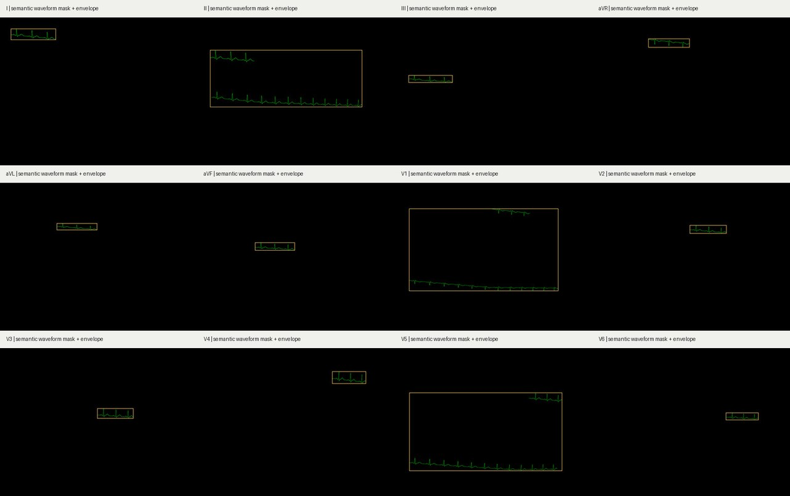
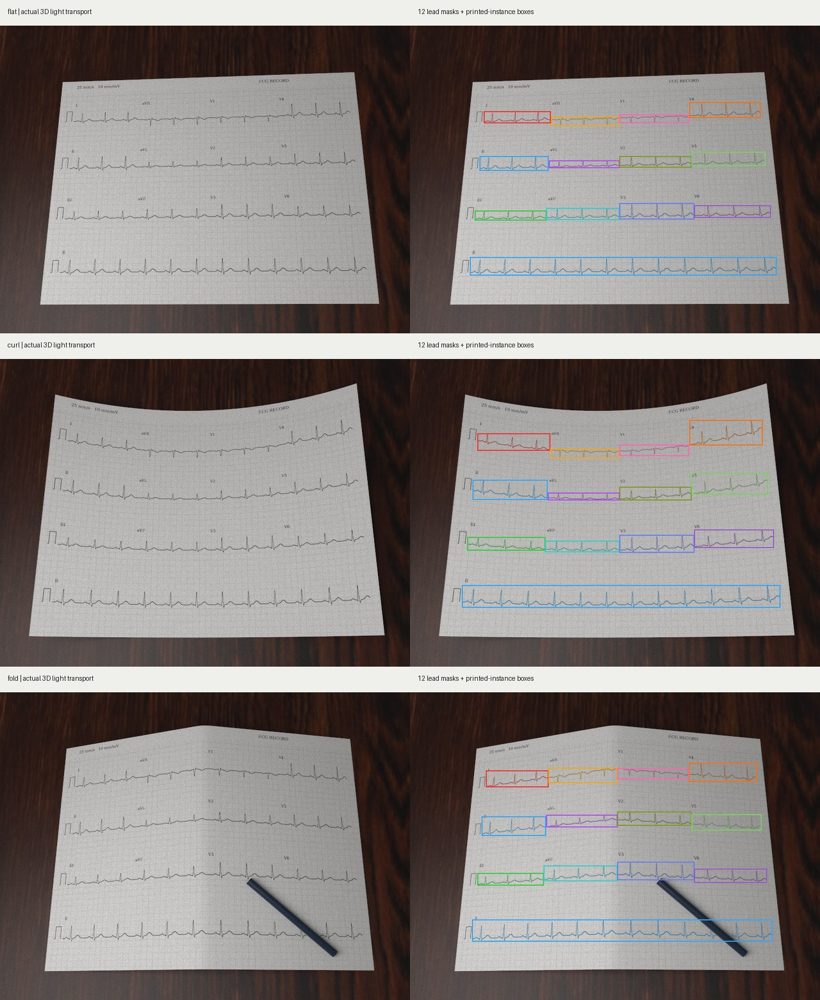

# Round 2: supervision, training and physical realism

Version 0.7.0 was reviewed by six parallel agents covering document-generation
research, supervision, training integration, scene physics, optics and
independent QA. The integrator added and exercised the optional 3D backend,
measured background asset, inspection examples and final release checks.

## What was wrong with the earlier appearance

The review agreed with the criticism that the earlier gallery looked
artificial. This was not resolved by the earlier unit-test count.

- Repeating sine-like wood patterns, broad pastel colour casts and sparse
  generic headers made scene generation recognizable.
- Scene lighting and interpolation multiplied display-encoded RGB rather than
  linear radiance. Optical filtering had the same domain error.
- Cast shadows used receiver height instead of projecting each caster point.
  A fixed contact halo could persist when the sheet lifted off the tabletop.
- Pen marks and artifact text were painted after deformation and could float
  in camera coordinates rather than follow the folded paper.

The first four physical/scene defects were corrected. The torch fallback now
uses neutral/correlated lighting, nonperiodic low-amplitude backgrounds and
material-attached annotations. A second, offline 3D backend makes actual light
transport available instead of representing every capture by a height-field
composite. Headers, printer morphology and scene diversity remain open gaps.

## Guaranteed output contracts within the tested domain

| Output | Meaning | Shape / convention |
| --- | --- | --- |
| `lead_masks` | Independent visible waveform coverage for I, II, III, aVR, aVL, aVF, V1..V6 | `[B,12,H,W]`, float32 |
| `lead_boxes` | One envelope over all visible occurrences of each canonical lead | `[B,12,4]`, xyxy pixel edges |
| `instance_masks` | Separate short/long printed occurrences | Up to `[B,15,H,W]` |
| `instance_boxes` | One visible printed occurrence, preferred for YOLO | Up to `[B,15,4]` |
| `instance_lead_ids` | Canonical class of each occurrence, including repeated II/V1/V5 | `[B,15]`, IDs 0..11 |
| `instance_active` and `instance_box_valid` | Valid object selection, including cropped/hidden/padded slots | Both must hold |
| `valid` | Visible geometric supervision support | `[B,1,H,W]` |

Right/bottom box edges are exclusive. Empty supervised boxes are `-1` and have
false validity. The YOLO adapter omits invalid entries, normalizes xywh and
retains repeated classes. Torchvision defaults to labels 1..12 because zero
is background. Fixed-shape adapters avoid dynamic CUDA packing.

These are waveform masks and waveform-tight boxes. They deliberately exclude
grid, text and calibration pulses. They are not whole layout-cell boxes.
For example, `lead_boxes` for II can span a short II and a long II far below
it. YOLO must use the two separate `instance_boxes` instead. The exporter does
not invent segmentation polygons around disconnected waveform pixels.

Independent tests used sparse-coordinate bounding-box oracles, all 30 layouts,
Cabrera polarity, repeated rhythm identity, non-square images, crop, tear,
pen/stamp coverage and exact export roundtrips. QA discovered and fixed an
intermediate edge-coverage regression in 291 pixels rather than adjusting the
expected image to hide it.

An actual RGB/NPZ pair is retained as `assets/supervision-rgb.png` and
`assets/supervision-targets.npz`, with box/class details in
`assets/supervision.json`. The example contains all twelve semantic channels
and fifteen active printed instances.

## Training exercised, not merely described

`examples/export_yolo.py` writes images, normalized labels, dataset configuration
and provenance. Group IDs determine train/validation membership before capture
assignment. Known source-ID/hash leakage is rejected. Callers must supply
correct patient grouping for their own data, including multiple recordings
from the same patient.

- Actual U-Net backward/optimizer steps passed with twelve independent output
  channels. The final compiled raster/scene run completed three optimization
  steps with finite loss and changed weights.
- Actual 12-class YOLO11n training and validation completed for one epoch on
  CPU using exported artificial images and an architecture YAML. No pretrained
  weights were used.
- YOLO validation mAP was **zero** on this tiny one-epoch smoke experiment.
  This proves an operational data/model/loss pipeline, not trained detection
  accuracy. The sanitized log is `ROUND2_YOLO_SMOKE.log`.
- An incompatible external torchvision wheel was identified and replaced by
  the matching official CPU build. Installation instructions and CI now
  explicitly install Torch/torchvision from the same backend index.

Segmentation loss support is task-dependent. The renderer's `valid` restricts
loss to visible paper and ignores tabletop negatives. Use an explicit support
including background if training visible-ink segmentation over the whole
image. Geometric validity does not imply optical readability.

## Actual 3D capture route

The optional `ecg_gpu.pathtrace` module uses Mitsuba 3. It creates a developable
mesh in meters from the canonical pixels/mm scale, integrates discrete unit
tangents, renders area-light transport and projects a measured tabletop
texture. The blank backside has a separate material. A physical cylinder
occluder rests on the local sheet rather than at an unrelated fixed height.

Labels are sampled from actual primary-camera ray intersections and visible
front-face UV coordinates. They are not obtained by rounding averaged shape
ID AOVs. Four stratified rays per pixel estimate geometric target coverage in
the provided example, independently of the 128 radiance samples per pixel.

Three captures were executed at 768×576 with 128 radiance samples per pixel:
flat, curled and folded/occluded. Each retains twelve visible semantic leads.
Camera, light and mesh configuration, source/reference/texture hashes, physical
extent and dependency versions are stored in `assets/pathtraced.json`.
The measured wood surface is CC0 and attributed in `../assets/ATTRIBUTION.md`.

Independent review caught and corrected a sharp-fold discretization error
before release. Maximum local edge error is now below `1e-4` in the permanent
tests, including the maximum configured bend. Separate asymmetric-colour
fiducials verified RGB-to-mask orientation. Occluder, backside, UV, tight-box
and full-provenance checks executed using Mitsuba itself.

This route is CPU/offline, with explicit file and asset work. It does not add
Mitsuba or CPU copies to the torch training hot path. Its single-source example
keeps every view in one partition rather than fabricating independent
training and validation patients.

## Release verification

The final CPU discovery ran **147 tests: 143 passed, 4 CUDA tests skipped**.
Mitsuba was installed and its real rendering tests executed. Compiled U-Net
training and wheel packaging passed. The numerical height-field audit retained
maximum interior UV error below 0.0011 pixel against the dense reference.

Source hashes, exact test log and numerical audit accompany
`ROUND2_VERIFICATION.json`, `ROUND2_TEST_LOG.txt` and `ROUND2_PAPER_AUDIT.json`.
CI covers minimum/current Torch, complete documentation, optional Mitsuba tests
and actual YOLO export/training. CUDA throughput and parity remain unmeasured
in this CPU environment.

## How far realism has advanced

The new 3D examples visibly improve material context, geometric occlusion and
light/shadow consistency. Independent reviewers still identify synthetic cues:
simple prescribed folds/curls, a uniform cylindrical pen, sparse generic
headers, clean thin edges and limited tabletop/camera diversity. Photon noise
also remains visible at the chosen finite path-tracing sample count.

The meshes are not simulated cloth. The torch mode remains a bounded 2.5D
approximation. Neither backend models every printer, paper, lens, sensor,
demosaicer, rolling shutter or scene condition. The provided demo waveforms
are artificial. Source signals are preserved, but physiological consistency
of caller-supplied channels is outside the image renderer.

**No evidence supports a claim of 100% realism or superiority over all other
ECG generators.** A defensible comparison requires held-out real ECG scans and
photographs, matched signals/layouts, device-separated evaluation, blinded
readability review and downstream real-data YOLO/U-Net performance. These
experiments have not been executed in this round.

The research review compared primary code/papers for Augraphy, DocCreator,
UVDoc, Doc3D/DocUNet, SyntheticDoc, DocSynth and ECG-Image-Kit. The practical
direction is measured or physically rendered geometry/materials plus exact
supervision, with the fast torch backend retained for training. See
`ROUND2_DOCUMENT_RESEARCH.md` for sources, licensing and acceptance criteria,
and the five other `ROUND2_*.md` reports for the independent reviews.
