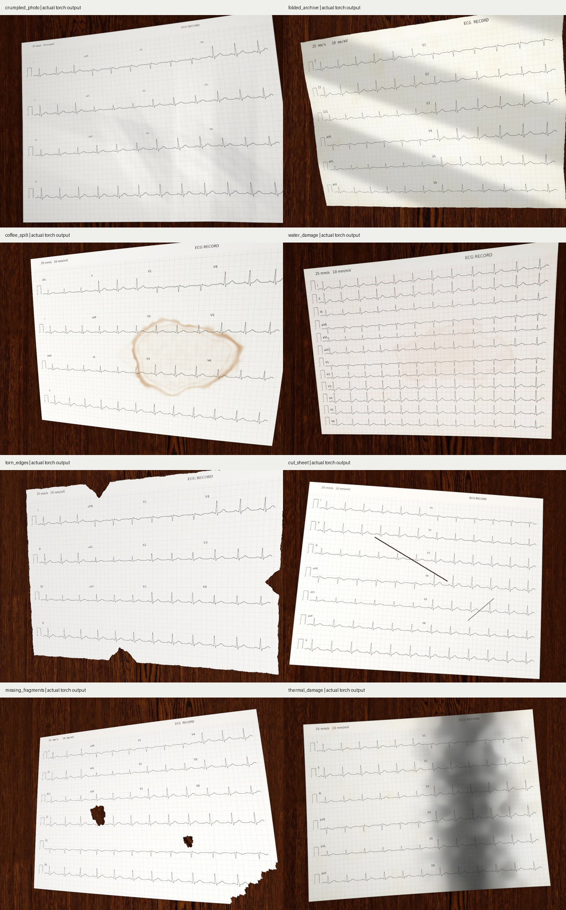
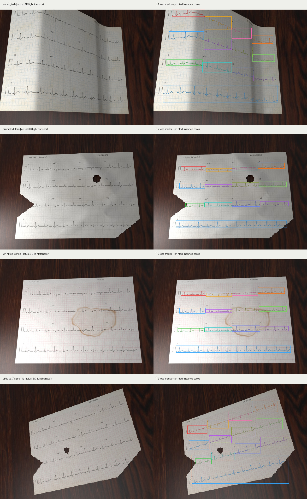
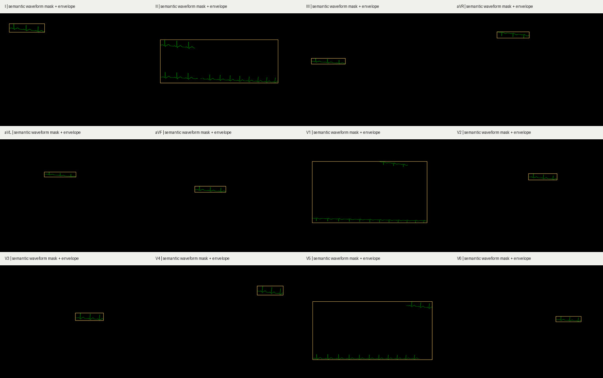

# Round 3: irregular paper, damage and material history

Version 0.8.0 addresses the request for more realistic crumpling, folds, cuts,
aging, stains, perspective and missing regions. Six agents covered geometry,
paper materials, substrate damage, 3D capture, primary-source research and
independent quality. The integrator reconciled their changes, revised capture
recipes, rendered the examples and retained the software and visual evidence.

## Concrete changes

| Phenomenon | Implemented mechanism | Supervision consequence |
| --- | --- | --- |
| Creases and crumpling | Finite asymmetric ridges branching from displaced junctions, unequal accordion panels and oriented micro-wrinkles | One material mesh drives inverse geometry, normals and shading |
| Aging | Unequal edge penetration, broad oxidation history, clustered foxing and subtle fiber density | Appearance changes, geometric trace ownership stays intact |
| Liquid damage | Nonperiodic multiscale capillary fields, irregular contact line, unequal pinning and secondary drying fronts | Deposits absorb linear light without pretending to be missing paper |
| Thermal damage | Mottled print fading separated from local coating development | Observability changes without altering supplied ECG samples |
| Tears and abrasion | Up to four irregular edge tears and bounded shallow wear | RGB, targets and shadow caster lose the same material |
| Holes and cuts | Three irregular internal punctures and three finite open kerfs, controlled in physical units | Missing areas remove trace masks and can split one printed instance |
| Missing corners | Four explicit corner orientations with irregular boundaries | Visibility changes, canonical lead IDs stay fixed |
| Perspective | Projective capture distinct from rotation/crop, with horizon checks, plus actual 3D sensor pose and camera up vector | Targets share the same inverse field or primary rays |
| Offline 3D | Seeded multifold, wrinkled and crumpled surfaces, static edge-metric relaxation and clipped substrate topology | Image, shadow and geometric targets intersect the same mesh |

The added recipes are `crumpled_photo`, `folded_archive`, `water_damage`,
`coffee_spill`, `torn_edges`, `cut_sheet`, `missing_fragments`,
`oblique_phone` and `thermal_damage`. Together with the seven existing recipes,
the package now exposes sixteen coherent capture scenarios.



## Review findings that changed the implementation

The first crumpling examples looked almost flat. Broad ambient illumination
concealed the normal variation. Increasing deformation made some recipes fail
the material metric gates, so that approach was rejected. The final torch
recipe uses broader facets, fewer overlapping crease branches and raking light
that reveals actual normals and self-shadowing. No independent dark crease
stripe is painted onto a flat sheet.

The conservative crumpled recipe was audited over 64 parameter samples at
strength .92. Its largest sample-mean absolute metric error was .0015384 and
largest q99 was .0225361. The exact recipe and audit are retained in
`ROUND3_RECIPE_AUDIT.json`. It represents mild crumpling within the bounded
2.5D model. Stronger examples use the offline 3D backend rather than silently
relaxing the torch geometry acceptance limits.

Independent native-resolution inspection caught another conspicuous defect:
whole-triangle deletion produced 8 to 15 pixel stair steps around holes and
tears. The corrected backend refines the existing surface and clips triangles
at interpolated support boundaries, preserving shared intersections and UVs.
The 768-pixel diagnostic measured 1,876 boundary segments with maximum projected
length 1.99 pixels. This is a concrete contour improvement, not a claim of
microscopic torn-fiber simulation.

The final oblique puncture case also exposed a numerical degeneracy: float32
UV quantization could collapse a clipped material edge while its spatial
coordinates remained different. The exporter rejected infinite mesh metrics.
The correction interpolates in float64, quantizes once for export and removes
explicitly bounded UV/spatial slivers. Metrics use float64 on every retained
edge and reject nonfinite values. Per-capture metadata records the numerical
limits and removed triangle count. The exact failing support case is now a
regression with runtime warnings promoted to errors and strict JSON encoding.



## Labels and training remain usable

The twelve lead masks, lead envelopes and up to fifteen printed-instance masks
and boxes retain the existing contract. Repeated rhythm strips preserve their
canonical class. Detection should use printed-instance boxes rather than a
single envelope spanning disconnected occurrences of the same lead.

Mask-derived boxes use exclusive right and bottom pixel edges. Empty boxes
remain -1 with false validity. Physical damage can hide an active printed
instance without deleting its identity. A stain or faded print does not remove
the geometric target. Optical readability and geometric visibility are still
different properties.

Independent checks enumerate mask coordinates, derive ellipse and capsule
support analytically, verify physical scaling on nonsquare pages and track
damage through perspective and rotation. They also verify source preservation,
checkpoint replay, geometry/material separation and rejection of unsupported
damage in the reduced-cost mode. The final missing-fragment example retains
all twelve channels and fifteen printed slots, with RGB, NPZ targets and box
metadata in the accompanying assets.



Actual compiled U-Net optimizer updates were repeated on artificial signals.
An eight-image YOLO dataset from four artificial source groups was exported
with `--scenario missing_fragments`. Actual one-epoch training and validation
completed without pretrained weights. Validation mAP was zero, so this is
integration evidence only. The same damaged-page export and training workflow
run in CI. Logs are retained in `ROUND3_TRAINING_SMOKE.txt`. Successful
optimization verifies integration, not useful real-ECG digitization accuracy.

## Reproduction

```bash
python examples/capture_scenarios.py --out build/scenarios \
  --width 1280 --height 960 --severity .85 \
  --background assets/backgrounds/wood_table_001_diff_1k.jpg
python examples/pathtraced_capture.py --adverse --out build/physical \
  --width 1024 --height 768 --spp 192
python examples/inspect_supervision.py --scenario missing_fragments \
  --out build/targets --background assets/backgrounds/wood_table_001_diff_1k.jpg
python examples/review_adversity.py --captures build/scenarios --out build/review
python -m unittest discover -s tests -v
```

Mitsuba is an optional dependency installed with `pip install '.[pathtrace]'`.
The 3D backend is offline CPU capture, separate from the torch training hot
path. The latter performs no image decoding, file operations or device-to-host
copies during rendering. Rich damage and material fields have a measurable
cost. `RenderConfig(damage_detail="edge")` selects the first-tear-only path and
rejects enabled holes, cuts, corner removal, abrasion or multiple tears.
The component CPU timings in `ROUND3_DAMAGE.md` are not GPU throughput claims.

## Evidence and remaining limits

Exact test counts, artifact hashes and backend versions are recorded in
`ROUND3_VERIFICATION.json`, with the full discovery log in `ROUND3_TEST_LOG.txt`.
The final local suite ran **194 tests: 190 passed and 4 CUDA checks skipped**.
All four 1024 by 768 captures used 192 radiance samples per pixel, completed
strict JSON/dataset export and reference the final path-tracing source hash.
Primary sources and the acceptance rubric are in `ROUND3_RESEARCH.md`. The five
other specialist reports explain implementation details and measured limits.

The final examples are generated from artificial demonstration waveforms.
They still use a sparse generic header and one measured CC0 tabletop texture.
The torch crumpling model is deliberately conservative. The 3D mesh has no
paper thickness, microscopic edge fibers, full plastic constitutive law,
self-contact, wet-paper mechanics or calibrated printer/camera distribution.
Its material-edge relaxation retains percent-level strain in strong cases,
recorded per capture. Finite path-tracing samples can leave visible noise.

The improvements were inspected in native PNGs as well as reduced review
sheets. They have not been validated against an independently held-out
collection of real photographs, in blinded assessment or in downstream
real-image digitization benchmarks. Neither 100% realism nor superiority over
all other ECG generators is established.
