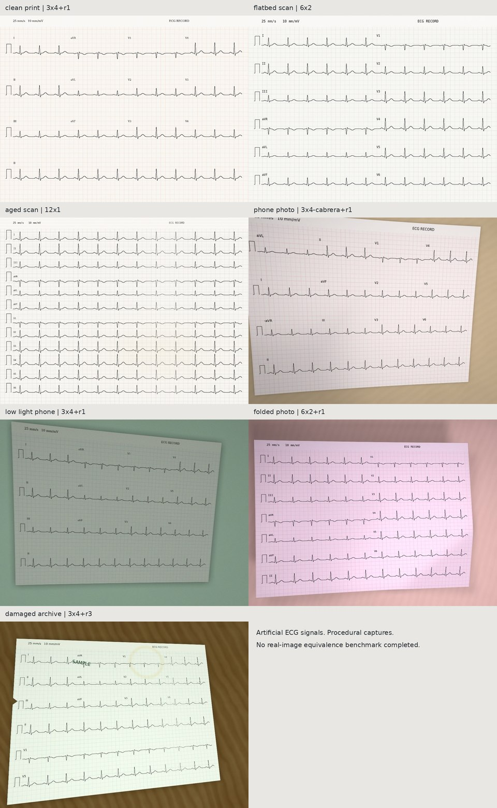

# ECG Torch Renderer 0.6.0 engineering review

Five agents worked in parallel as research, physical capture, document fidelity,
performance and independent QA reviewers. A coordinating integrator reconciled
their changes, added capture scenarios, inspected the generated images and ran
packaging, compiled training and numerical paper checks. `AGENTS.md` retains the
roles and acceptance workflow for future work.

## Delivered behavior

| Area | Change | Evidence |
| --- | --- | --- |
| Optics | Uniform finite shutter path convolved with Gaussian defocus | Independent 4096-step quadrature, motion variance and orientation checks |
| Sensor | Independent read/shot variances add in quadrature | Statistical variance and replay tests |
| Fidelity | Immutable layout definitions, explicit timing and physical scale | All 30 layouts, Cabrera sign, all 9 speed/gain pairs, pulse geometry |
| Input contracts | Reject invalid lengths/categories before lossy conversion, invalid opacity and numerical overflow | Independent adversarial regressions, including tiny fractional inputs |
| Provenance | Canonical decoded-input fingerprints and canonical output resolution | CLI digest, source isolation and metadata checks |
| Supervision | Avoid unnecessary 12-channel allocations for union and instance-only requests | Bitwise equality and allocation tests |
| Capture scenarios | Seven coherent scanner, phone and archive recipes with all twelve leads active | Replay, visibility and scanner-lighting tests, exported gallery |
| Delivery | Wheel, examples, maintained documentation and compatibility CI | Wheel build, three compiled training steps, local documentation compilation |

The source waveform remains unchanged. Optical degradation affects the RGB
observation. Geometric masks retain the intended trace location, and explicit
occlusions affect validity. A shadowed or blurred pixel can be geometrically
valid while unreadable.

## Actual generated examples



The contact sheet uses clean print, flatbed scan, aged scan, phone photography,
low-light capture, folded paper and damaged archive recipes. It includes 3×4,
6×2, 12×1, Cabrera and repeated rhythm strips. Seeds, every sampled control,
configuration, physical scales and exported PNG digests are retained in
`assets/scenarios.json`. The PNGs can be recreated with:

```bash
python examples/capture_scenarios.py --out build/scenarios
```

The source ECGs are entirely artificial and are not a physiological or clinical
validation set. The review found recognizable grids, labels, traces, paper
edges, perspective, fading and occlusions. This was an integrator's visual
inspection, not a blinded realism study.

## Validation actually executed

- Python 3.12 and PyTorch 2.14.1+cpu, no CUDA device.
- Integrated discovery: **102 tests run, 99 passed, 3 CUDA skips**, 24.577 s.
- After the last precision guards: **16 adversarial tests passed**.
- After constructor validation changes: **13 module/CLI tests passed**.
- Final scenario checks: **3 tests passed**, including all recipes and scale metadata.
- Frozen legacy raster fixture and archived 0.2.1 implementation retained.
- Wheel for 0.6.0 built successfully without dependencies bundled.
- Three U-Net optimization steps with compiled raster and scene passed, with
  finite losses decreasing from 0.6870 to 0.6777 in this smoke run.
- Eight material surface families checked against a dense inverse reference.
  Maximum interior UV disagreement was below 0.0011 pixel. Exact results and
  source hashes are in `SWARM_PAPER_AUDIT.json`.
- Static documentation compiled into 18 pages. Local full asset validation was
  blocked by an incomplete download of the unchanged historical gallery.
  The complete-checkout CI retains the full link, figure-hash and API checks.

These checks demonstrate engineering contracts within the tested environment.
They do not establish real-image equivalence, cross-version bitwise identity
or clinical model performance.

## Measured optimization

CPU target postprocessing only, two threads, masks `[2,12,384,512]`:

| Requested union | Original median | Optimized median | Visible allocation peak, original → optimized |
| --- | --- | --- | --- |
| Soft | 1.559 ms | 0.514 ms | 22.02 MB → 3.15 MB |
| Binary | 13.585 ms | 0.898 ms | 42.47 MB → 3.54 MB |

Every compared output was bitwise identical. This measures a postprocessing
stage, not end-to-end throughput. Timings are environment-specific and GPU
performance was not measured. `SWARM_PERFORMANCE.md` records the original
implementation provenance, raw measurements and reproduction script.

## Remaining acceptance work

The repository now has better optical models, input contracts and repeatable
capture cases. **Hyperrealism has not yet been demonstrated against independent
real photographs.** The key remaining work is evidence, not an artifact count.

1. Run the current release's profiler and CUDA contract tests on actual GPUs.
2. Calibrate the scene and camera distributions against an independent corpus
   of scanned, printed and photographed ECGs, separating devices by split.
3. Compare to ECG-Image-Kit using the same supplied waveforms and matched
   degradation budgets. Evaluate a fixed downstream digitizer on real held-out
   images with signal reconstruction metrics and uncertainty intervals.
4. Conduct blinded expert realism/readability assessment, stratified by layout,
   resolution and degradation severity. Include unreadable failures.
5. For severe paper self-occlusion, use externally rendered 3D asset banks.
   The in-loop procedural geometry remains a bounded 2.5D approximation.

The camera uses a normalized 9×9 optical kernel and Gaussian sensor noise.
It is not a calibrated named-camera model. Canonical resolution metadata makes
temporal/amplitude sampling limits visible, but cannot restore information
lost within an output column. The software accepts supplied channels and
does not enforce physiological lead consistency or invent diagnoses.

Supporting reviews: `SWARM_RESEARCH.md`, `SWARM_FIDELITY.md`,
`SWARM_PERFORMANCE.md` and `SWARM_QA.md`.
