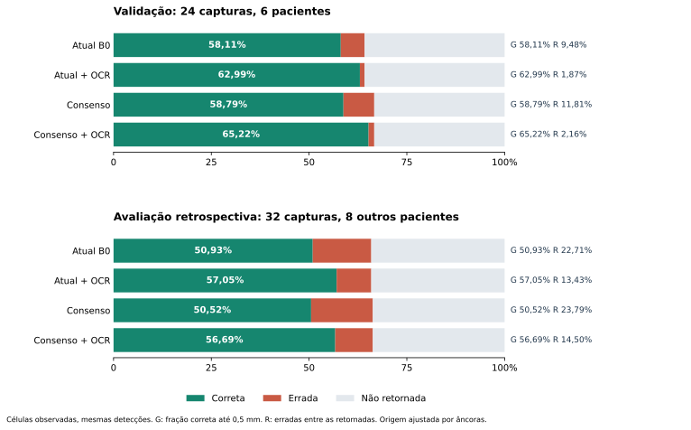
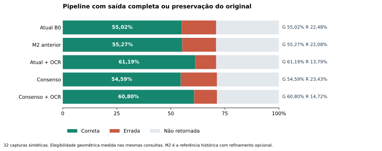
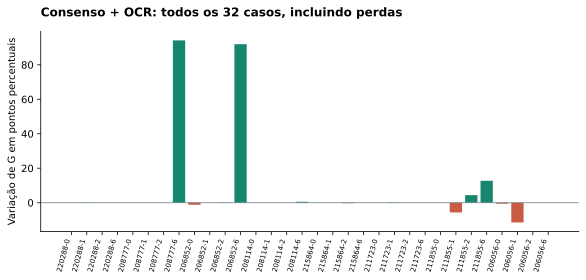

# Image-only grid organization and ECG-text orientation

M5 showed that perfect point localization does not establish correct physical
grid coordinates. This cycle implements two separate opt-in improvements and
evaluates them on identical detector observations with the frozen M3 queries.

`organize_consensus_lattice` tests competing axial bases, permits different
horizontal/vertical pitch, follows local spacing changes and integrates integer
constraints in confidence order. Disconnected observed components may be aligned
only after bounded, redundant projective agreement. Missing nodes and cells are
not generated. All competing hypotheses and the selected structural score are
returned. Geometry alone leaves semantic page orientation unresolved.

`infer_text_orientation` reads original-image ECG labels in four quarter
rotations through explicitly requested local Tesseract English OCR. Two distinct
strong lead labels or two recognized header words, a minimum score and a margin
over the runner-up are required. Repeated labels do not create extra evidence.
An incomplete OCR execution, weak evidence or ambiguity leaves orientation
unresolved. Raw TSV alternatives, runtime hashes and the image hash are retained.
OCR preprocessing never replaces the original RGB sampling source.

## Use

Install the existing `digitization` extras and a local Tesseract executable with
English language data to request text orientation. Neither feature downloads a
network or modifies the original detector weights.

```bash
python examples/rectify_denoising_grid.py \
  --checkpoint /path/to/joint-1973.pt \
  --image /path/to/ecg.png --out build/oriented-ecg \
  --page-orientation text --pixels-per-mm 4
```

The existing organizer and no semantic orientation correction remain the CLI
defaults. Physical pitch still assumes major 5 mm intersections. Neither the
OCR confidence nor the geometric support mask is a calibrated error probability.
The full-frame writer samples original RGB and maintains separate geometric
evidence. It preserves the original when its complete map is rejected.
`--organizer consensus` is a separate experimental option. The retrospective
results below do not justify replacing the current organizer.

## Evaluation contract

Development uses the 24 frozen validation captures from six patient groups.
The 32 already inspected M3 test captures from eight other patient groups are
a retrospective evaluation, not a new unseen holdout. The detector weights and
all query archives remain unchanged. Fresh validation detections are cached
once and reused in every arm. Only RGB enters OCR and only detector coordinates
and confidence enter grid inference. Gold fields and query references reach the
scorer after inference. No smoothing, waveform restoration or new training is
part of this comparison.

Four arms isolate the existing organizer, the consensus organizer, text
orientation with the existing organizer and the combination. Primary scores use
native orientation and one anchor-only translation at 0.5 mm. Secondary D4
registration is diagnostic only. Complete RGB output, coordinate eligibility
and partial-cell scores are evaluated separately. All scheduled failures must
stay in the denominator. The B0 full pipeline uses the unchanged CLI default
without optional point refinement. The previous M2 reference with refinement
is also reported from its frozen M3 results.

The scope is synthetic development geometry. There is no claim of clinical
validation, improved waveform accuracy, automatic lead layout/calibration or
superiority to an external complete digitizer.

## Completed retrospective results

Paper-domain primary scores at 0.5 mm, balanced by eight patient groups and two
render backends. G is correct queries divided by all fixed queries. W is wrong
returned queries divided by all queries. C is returned coverage and R is W/C.

| Pipeline | G correct | W wrong | C returned | R wrong among returned |
| --- | ---: | ---: | ---: | ---: |
| Existing default B0 | 55.0201% | 15.9515% | 70.9717% | 22.4759% |
| Previous M2, frozen reference | 55.2719% | 15.6647% | 70.9366% | 22.0826% |
| Existing organizer plus text orientation | 61.1877% | 9.7839% | 70.9717% | 13.7857% |
| Consensus organizer | 54.5883% | 16.7084% | 71.2967% | 23.4350% |
| Consensus plus text orientation | 60.8017% | 10.4950% | 71.2967% | 14.7202% |

Text orientation with the existing organizer gains 6.1676 pp in G, paired
patient-bootstrap descriptive 95% interval [0.3525, 14.4348] pp, with unchanged
coverage. It improves G in three captures and ties in 29, with no observed G
loss in this finite panel. This does not establish a universal no-harm bound.

The combination was selected by validation partial-cell G subject to W not
exceeding baseline. It raised validation G from 58.1055% to 65.2161%, with R
falling from 9.4813% to 2.1640%. That validation advantage over text orientation
alone did not persist retrospectively. The combination gains 5.7816 pp over B0
retrospectively, interval [-0.3731, 13.8618] pp, with nine improved, six worse and
17 tied captures. Its G is below the existing organizer plus text orientation.
Keep the consensus organizer experimental. `selection.json` preserves the
choice made before retrospective coordinate evaluation, rather than rewriting
it after seeing the results.

All four pipelines resample RGB in 18/32 captures. The other 14 preserve the
original and may retain partial observed-cell coordinates. Better coordinate
scores do not imply increased full-image rectification availability.

OCR resolves 13/32 inputs and leaves 19 unresolved. Three cases contain an
incomplete OCR alternative and remain unresolved, including the bounded
timeouts. A zero quarter turn in an unresolved receipt is not evidence that
the original orientation was correct. The fixed rule is not a calibrated
orientation probability.





## Image integrity and independent audit

Saved coordinate arrays were recounted without importing the organizer,
rectifier, CellMap or scoring implementation. The audit passes 5,632 metric
count checks across validation and retrospective evaluation, and 18,432 RGB
samples are compared against independent barycentric interpolation and original
source sampling. All 32 B0 full maps and eligibility arrays exactly reproduce
the frozen M3 B0 arrays.

The audit detected one truncated PNG shared by four exact-geometry variants.
It was recovered from the already-written duplicate produced from the same
warped array. A fresh full-frame resampling independently confirms all
15,354,858 RGB channel values match that recovery. No coordinate array or
score changed. `PNG-recovery.json` retains the original and recovered hashes.
The CLI now verifies every decoded RGB value before atomically publishing a
PNG. Tests inject truncation and altered pixels and verify an existing complete
file is not overwritten. The original binary regression fixtures are untouched.

Independent affine, projective, anisotropic, missing-row, fractional-phase,
integer-rotation and text-ambiguity tests cover the new behavior. Full CI and
local incomplete-checkout results are recorded in `validation.json`. CUDA was
unavailable locally. No GPU resource was provisioned for this cycle.

Exact duplicate geometry inputs are computed once per case, with the OpenCV
seed fixed at 1973. All method results and output paths remain. The 128 full
variant slots include 73 exact input reuses. This is exact deterministic reuse,
not approximation. Per-case execution times are not a per-method latency
benchmark, and separate OCR durations include its timeouts.

## Reproduction

Use the unchanged M2 capture bank and M3 query archives from the earlier
measurement artifacts. The new compact measurement ZIP contains the 24 fresh
validation detector observations. Expand its exact aliases first:

```bash
python examples/restore_compact_measurements.py /path/to/extracted-m6

python examples/infer_ecg_text_orientation.py \
  --bank /path/to/nextgen-bank --schedule /path/to/m3/comparison/schedule.json \
  --out build/m6-ocr-validation --split validation

python examples/infer_ecg_text_orientation.py \
  --bank /path/to/nextgen-bank --schedule /path/to/m3/comparison/schedule.json \
  --out build/m6-ocr-test --split test

python examples/evaluate_consensus_lattice.py \
  --bank /path/to/nextgen-bank --comparison /path/to/m3/comparison \
  --observations /path/to/extracted-m6/observations \
  --orientation-receipts build/m6-ocr-validation \
  --out build/m6-validation --split validation

python examples/evaluate_consensus_lattice.py \
  --bank /path/to/nextgen-bank --comparison /path/to/m3/comparison \
  --observations /path/to/extracted-m6/observations \
  --orientation-receipts build/m6-ocr-test \
  --out build/m6-test --split test --render

python examples/audit_consensus_results.py \
  --bank /path/to/nextgen-bank --comparison /path/to/m3/comparison \
  --evaluation build/m6-test --out build/m6-test/independent-audit.json
```

The compact ZIP stores one copy per byte-identical SHA256 payload. The restore
script recreates every recorded path with hard links or exact copies and
refuses to overwrite different existing files. Its manifest retains all
per-file hashes and the intentionally corrupted evidence separately. Source
code stays in this repository. Runtime and checkpoint hashes are in
`runtime.json`, and the ZIP hash is in `measurement-archive.json`.

## Next gate

Prioritize rejection of wrong lattice identities and pitch harmonics, orientation
when labels are unreadable, and conditional waveform extraction with these
estimated maps. A new patient-disjoint set with independent real printed/photo
measurements is required before promoting a new default or making external
performance claims.

Derived ECG inputs retain the original PTB-XL attribution and CC BY 4.0 terms,
DOI 10.1038/s41597-020-0495-6. Tesseract and its installed English language data
remain external dependencies and are not redistributed.
