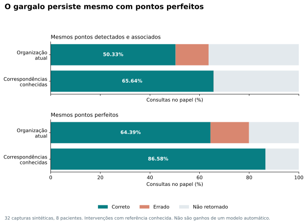
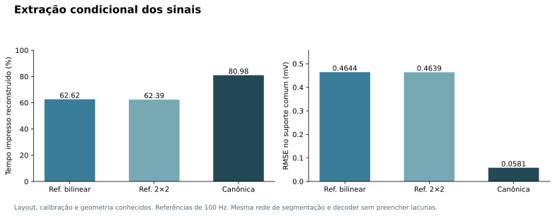
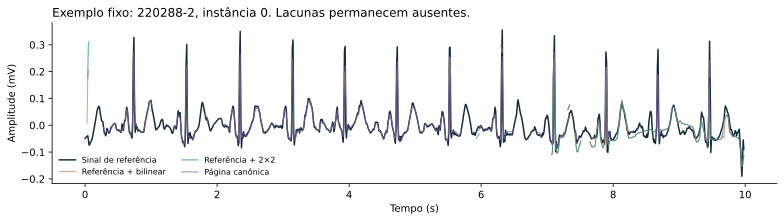

# ECG digitization M5: executed stage diagnostics

High point-detection F1 does not establish correct physical coordinates. This
development experiment isolates the current lattice organizer from point
localization, then evaluates conditional waveform extraction separately.
Production defaults, detector weights and the frozen M2/M3/M4 evidence remain
unchanged. This is not an improved automatic model or an external clinical test.

## Reproduction completed

- All 112 recovered capture hashes match the original bank manifest.
- The 160 scheduled M3 case/method results reproduce the original summary
  byte for byte, SHA256 `f23de9fbba72d75b36a13553b9147c35dd82953f7c83ae6e88fbefdb42c240c5`.
- The checkpoint is `joint-1973`, SHA256
  `8115e99c3517dc0b99974b9e64744aab9eb961fd0da06f1e84a65a1e45c3dbf8`.
- Fresh CPU inference reproduces both coordinates and scores exactly on all
  32 M3 diagnostic captures. These are checks of reproduction, not new patients.
- Fourteen original public PTB-XL WFDB records were downloaded from the
  publisher's S3 mirror. Header and data hashes match the frozen provenance.
- The final geometry driver was rerun after import-only lint cleanup. Case
  measurements remain byte-identical to the first run.

## Geometry diagnostic results

Paper-domain G/W/C/R at 0.5 mm, balanced by eight patients and two render
backends. The panel is the already inspected 32-capture M3 development panel.

| Intervention | G correct | W wrong | C returned | R = W/C |
| --- | ---: | ---: | ---: | ---: |
| Existing native M2 | 55.2719% | 15.6647% | 70.9366% | 22.0826% |
| Native M2 plus oracle D4 orientation | 68.1664% | 2.7702% | 70.9366% | 3.9052% |
| Matched detected points, inferred organization | 50.3296% | 13.2965% | 63.6261% | 20.8979% |
| Same matched points, known IDs | 65.6380% | 0.0725% | 65.7104% | 0.1103% |
| Perfect points, inferred organization | 64.3929% | 15.5487% | 79.9416% | 19.4501% |
| Same perfect points, known IDs | 86.5768% | 0% | 86.5768% | 0% |

On the same matched observations, the known-ID construction raises G by
15.3084 percentage points, descriptive paired patient-bootstrap 95% interval
[8.5068, 22.0673] pp. On identical perfect observations, it raises G by
22.1840 pp [14.7644, 28.9764]. There are 20,000 draws and eight independent
patient groups. These are development diagnostics without multiplicity control.

The construction changes lattice organization, semantic orientation, identities
and retained components/cells. It does not isolate the scalar pitch alone.
The E2 matched-observation pair excludes unmatched/duplicate detections in both
arms. Comparing the oracle E2 arm directly with all native observations would
also change false-positive selection and support. The paired control prevents
calling that contrast an ID-only effect on all original detections.

Counterfactual maps emit partial coordinates, not rectified RGB. Their
coverage differs from a full-image method and all missing support remains in
the denominator. Zero wrong queries in the E4 finite panel is not a universal
or clinical error bound. The native fallback frequency remains a separate
operational result from M3.

`geometry-independent-recount.json` records 1,280 independent recount checks
using saved arrays, anchor medians and Euclidean errors without importing the
scoring core. Every scheduled case and all five new component arms remain.

## Conditional E5/E6 waveform study

The experiment uses the original synthetic captures and a regenerated canonical
page with the original print seed, source waveform, speed, gain and layout.
The common segmentation network is the unchanged Open-ECG-Digitizer UNet from
Ahus-AIM, source commit `97a15087d4abcda843da8c58ee74b1d8f47e6f9a`, with
checkpoint SHA256 `17fe7071ef270102631306127262fc08c250d79d4e3aeb572ab1719dd34d320b`.
Upstream source and weights are not redistributed.

Known print metadata and geometry are deliberately supplied. The existing
missing-aware region decoder retains gaps and separate printed instances.
No time, DC or amplitude alignment is fitted to the reference signal.
The study is not the complete native npj algorithm and does not evaluate
automatic layout/calibration inference. The original references are 100 Hz.

E5 inverts the saved dense reference through adjacent 8-pixel source cells.
The approximation error and support are measured on held-out M3 queries for
every case. It compares bilinear source sampling with fixed 2x2 output
quadrature. E6 measures the canonical-page extraction floor. E5/E6 differences
include capture damage, visibility, sampling and extractor transfer. Fixed
2x2 sampling is not a universal preservation rule. The complete panel finished with 96 case/method results, 32 cases and eight patients.


### Completed conditional waveform measurements

| Input to the common extractor | Printed-time coverage | Conditional RMSE (mV) | Common-support RMSE (mV) |
| --- | ---: | ---: | ---: |
| Reference-field warp, bilinear | 62.6199% | 0.49171 | 0.46441 |
| Reference-field warp, 2x2 quadrature | 62.3915% | 0.49357 | 0.46386 |
| Regenerated canonical page | 80.9774% | 0.06715 | 0.05812 |

All-case coverage is patient/backend balanced. RMSE is conditional on observed
printed samples. Common support is the same 58.4927% of printed times in all
three arms, with defined common-support errors in all 32 cases. The reporting
script independently verifies the saved reference/time arrays and recounts
coverage/errors with 2,484 checks.

The 2x2 arm changes coverage by -0.2284 pp, paired descriptive 95% interval
[-0.6001, +0.0998] pp, and common-support RMSE by -0.00055 mV
[-0.00271, +0.00201]. This does not support promoting it as a better complete
signal method on this panel.

Severe failures are retained. For the bilinear arm, 215864-6 has RMSE 6.81044 mV
at 59.11% coverage, and 206852-2 has RMSE 4.02439 mV at 23.00% coverage.
The global average must not hide these falsely accepted trace peaks. A post-hoc
alignment check warps the archived clean target in these two cases and finds
MAE 0.830 and 1.534 encoded channel levels against the regenerated canonical
page on full source support. It supports alignment in these two examples,
without proving every waveform point or establishing a camera model. No
parameters were tuned from this check.

The reference-field approximation has maximum case p95 error 0.04429 mm on
the saved geometric queries, and minimum query coverage 94.4580%. It is still
an approximation of renderer-exported truth, not independent physical metrology.
All data are synthetic. The E5/E6 comparison combines capture damage,
visibility, sampling and extractor transfer, so it does not identify any one
of those causes alone. The missing-aware decoder and fixed crops used here
are a conditional diagnostic backend, not the original npj end-to-end method.







## Validation and artifacts

All seven remote CI jobs pass on source commit
`de801305d261e0126bdf7c4935b55a16e29a7204`, including all three Python/Torch CPU
matrices, quality, documentation, optional integrations and the authentic
digitization reference chain. The final result supplement changes tables,
figures, reporting and documentation, with no inference-driver changes.
See `validation.json` for the local incomplete broad-checkout attempts and
original-fixture limitations. No expected binary fixture was regenerated.

The full measurement archive contains raw new coordinate and waveform arrays,
conditional raster outputs, source provenance and per-case support. Repository
source is not duplicated in that archive. The self-contained Portuguese report
is delivered separately. All original measurement banks remain unchanged.

## Reproduction commands

Recover and combine the two original M2 bank archives into `nextgen-bank/`,
and unpack the M3 measurement archive as `m3/`. The complete original archive
names and hashes remain in the experiment deliverables. Keep the old arrays
and locks unchanged. Install the package and CPU image dependencies.

```bash
python examples/diagnose_digitization_stages.py \
  --bank /path/to/nextgen-bank \
  --comparison /path/to/m3/comparison \
  --out build/m5-geometry \
  --fresh-detector /path/to/joint-1973.pt

python examples/audit_digitization_stage_results.py \
  --comparison /path/to/m3/comparison \
  --diagnostic build/m5-geometry \
  --out build/m5-geometry/independent-recount.json

python examples/diagnose_digitization_signals.py \
  --bank /path/to/nextgen-bank \
  --comparison /path/to/m3/comparison \
  --sources /path/to/original-wfdb-records \
  --upstream /path/to/pinned/Open-ECG-Digitizer \
  --out build/m5-signals

python -m unittest discover -s tests -p test_digitization_stage_diagnostics.py -v
```

Use a new output directory. Neither driver tunes the production estimator.
Full coordinate arrays, signal predictions and images are delivered separately.
Compact tables and exact protocols are committed here.

## Decision

The next implementation priority is the discrete grid decoder, including
orientation, identity/pitch hypotheses and multiple components. Better point
localization alone leaves substantial wrong geometry even with perfect points.
Retain image/signal preservation and externally measured calibration as
independent acceptance gates. A fresh external test is still required.

## Attribution

The common segmentation frontend is from Stenhede, Bjørnstad and Ranjbar,
*Digitizing paper ECGs at scale: an open-source algorithm for clinical research*,
npj Digital Medicine (2026), DOI 10.1038/s41746-025-02327-1.
Upstream code/checkpoints retain their own licence. The preprocessing and
conditional decoder used here do not represent the commercial PMcardio product.
PTB-XL source signals retain CC BY 4.0 attribution,
DOI 10.1038/s41597-020-0495-6.
