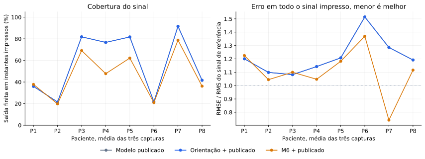
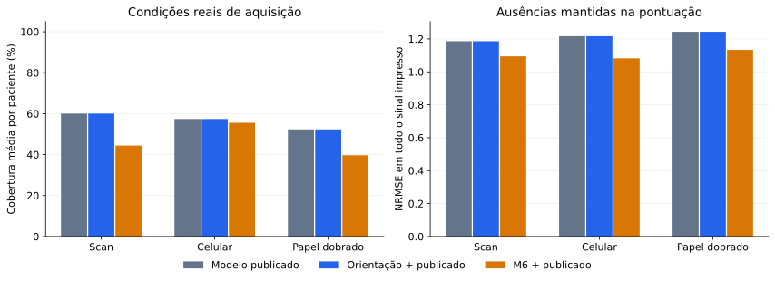
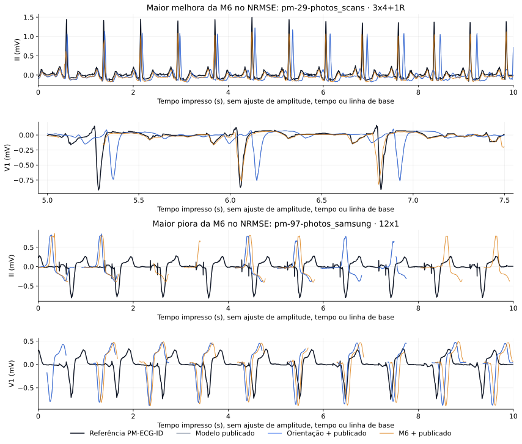

# M7 external full digitization pilot

This pilot closes the previous gap between grid-coordinate evaluation and full
RGB-to-waveform evaluation. It compares pinned Open-ECG-Digitizer inference,
text orientation followed by that same pipeline, and M6 rectification followed
by that same pipeline. It changes no production/default inference settings.

The sample contains 24 physical-capture images from eight PM-ECG-ID patients:
scans, Samsung phone photographs and photographs of bent paper. There are two
patients per single-page layout: standard 3x4, 3x4 plus one rhythm, 6x2 and 12x1.
The two initially selected overlapping recordings were excluded before inference.
Selection excludes every known previously used patient, including prior cohorts
explicitly excluded from the last synthetic bank. Variants stay with their patient.

The three arms receive RGB, a fixed ten-second duration, 500 Hz output and the
fixed 10 mm/mV convention. Inference receives no reference signal, true layout,
lead ownership or physical grid coordinates. References are loaded after each
inference. The reference cutouts are placed on the printed horizontal time axis.
Long-rhythm identity is verified against exact matching short-lead source samples.

## Protocol and interpretation

- `protocol.json` records the choices fixed before inspecting external results.
  This is a small development pilot, not a preregistered confirmatory trial.
- `manifest.json` pins the 24 source images and eight prepared references.
- `prior-groups.json` is a portable exclusion set with provenance retained in
  the original exclusion-manifest hashes.
- Primary outcomes are patient-macro printed-sample coverage and raw all-printed
  NRMSE. Missing predictions receive a zero-valued scoring penalty only.
  No failed reconstruction is saved as a successful zero waveform.
- Secondary alignment permits +/-100 ms and separate DC centering, fits no
  amplitude scale, and requires >=90% of ORIGINAL printed lead support.
- Failed, empty, partial and wrong-layout results stay in the denominator.
  The <90% lead-coverage threshold is an engineering definition, not clinical acceptance.
- The summary averages capture variants within patient before averaging patients.
  Descriptive paired bootstrap intervals use 20,000 patient resamples and seed 20261026.
- Reused native predictions require identical decoded RGB bytes and shape, the
  same model/configuration and the same random seed. Cache hits are explicit.
  Execution cost must not be advertised as independent deployment latency.

The native code is unchanged at commit
`97a15087d4abcda843da8c58ee74b1d8f47e6f9a`, with hash-verified published weights.
The generic preset uses the full published layout catalogue. This CPU pilot
sets the maximum side to 1500 pixels, rather than the published preset's 3000.
M6 uses `banding`, the baseline organizer, text orientation, zero refinement
and 4 pixels/mm. Its comparison includes geometry, orientation and RGB
resampling. It does not isolate geometry accuracy from sampling effects.

The M7 scorer, runner and preparation code were published in commit
`1709fd205ad418617d2ddaef94dbc0d01b609721`. All seven CI jobs passed on that
commit. Python 3.12 full integration ran 497 tests with 25 skips and no failures.
The local reconstructed checkout lacks the original `raster-v021.npz` fixture:
its full 497-test attempt has two missing-file errors and 25 skips. The fixture
was not regenerated. The complete remote checkouts passed those same tests.

## Reproduction

Use the project environment and upstream inference dependencies. Obtain the
original PTB-XL 1.0.3 `ptbxl_database.csv`. Its SHA-256 is
`7600de9c1b27d181d850b3c6038a35d7c3ddb6bb33b702e3a20252a6859d216b`.

```bash
python examples/prepare_pm_ecg_external.py \
  --root build/pm-external \
  --ptbxl-metadata /path/to/ptbxl_database.csv \
  --exclude research/external-digitization-m7-20261026/prior-groups.json \
  --fetch-missing

python examples/run_external_digitization.py \
  --manifest build/pm-external/manifest.json \
  --out build/pm-external-run \
  --upstream /path/to/pinned/Open-ECG-Digitizer \
  --checkpoint /path/to/joint-1973.pt

python examples/audit_external_digitization.py \
  --manifest build/pm-external/manifest.json \
  --run build/pm-external-run \
  --out build/pm-external-independent-audit.json

python examples/summarize_external_digitization.py \
  --manifest build/pm-external/manifest.json \
  --run build/pm-external-run --out build/pm-external-summary
```

The preparation tool fetches only selected ZIP members with exact HTTP ranges,
validates their CRC and records their SHA-256. It does not claim to validate
the MD5 of the complete 33.9 GB archive. The published ZIP has 6600 page rows
for 6000 ECG-condition entries, because some records have multiple pages.
Multipage records are outside this pilot.

The portable combined exclusion file produces the same selection, with a
correspondingly different exclusion-file provenance hash. Byte-for-byte replay
of the original manifest should use the measurement archive's frozen inputs.
The original inference checkpoint and all upstream assets remain separately
supplied, hash-verified dependencies, not newly trained models.

`audit_pm_ecg_sources.py` separately checks every reference against the eight
original 500 Hz PTB-XL WFDB records. Obtain their `.hea` and `.dat` files from
the public `records500/` paths corresponding to the manifest recording IDs.
The audit validates WFDB checksums and initial values. It verifies all 96
lead/time windows after measuring the constant DC shifts made by PM-ECG-ID.
Maximum residual is 4.026e-7 mV. It does not alter the scoring references or
any inference output.

## Limits and attribution

This is an external image-acquisition source, not proof of unseen patients for
every upstream model. Upstream training overlap with PTB-XL is unknown. There
is no full commercial Powerful Medical or full Kaggle-ensemble execution here.
Published SNR/PCC/RMSE values use different alignments, resolution, failures,
cohorts and aggregation. They cannot be copied into this pilot as matched
competitor measurements. Eight patients and three conditions do not establish
clinical equivalence, hospital/manufacturer generalization or state of the art.

Sources:

- Iring et al., PM-ECG-ID v1, DOI 10.5281/zenodo.13617673,
  https://zenodo.org/records/13617673, GPL-3.0-or-later.
- Wagner et al., PTB-XL 1.0.3,
  https://physionet.org/content/ptb-xl/1.0.3/, CC BY 4.0.
- Stenhede, Bjørnstad and Ranjbar, npj Digital Medicine (2026),
  DOI 10.1038/s41746-025-02327-1. Code and pretrained weights from
  https://github.com/Ahus-AIM/Open-ECG-Digitizer, CC BY-SA 4.0.
- Demolder et al., Journal of Electrocardiology (2025),
  DOI 10.1016/j.jelectrocard.2025.153900.

The compact measurement archive contains saved waveform arrays, reference
arrays, original WFDB files, geometry arrays, logs and summary figures. It
excludes source photographs and reconstructed RGB pages. After extracting it,
waveform and source-data audits can be replayed without running any network:

```bash
python examples/audit_external_digitization.py \
  --manifest /path/to/extracted/inputs/manifest.json \
  --run /path/to/extracted/run --out /path/to/recount.json --signals-only

python examples/audit_pm_ecg_sources.py \
  --root /path/to/extracted/inputs \
  --original-wfdb /path/to/extracted/inputs/original-wfdb \
  --out /path/to/source-recount.json
```

`--signals-only` explicitly omits decoded-RGB input checks. The full audit used
for publication checks decoded input pixels and exact cached prediction parity
as well. Both modes independently recount coverage, raw errors and the declared
aligned errors, without importing the evaluator implementation.

## Completed pilot results

All 72 scheduled outcomes completed, with no execution exceptions. This is
not a claim that all images were correctly digitized. The independent audit
verified 3745 measurements, all decoded native RGB inputs and 27 exact-RGB
prediction cache replays. There were 45 actual native forward calls, with the
same 72 scheduled outcomes retained. M6 resampled 21 images and preserved
three originals.

| Patient-macro outcome | Published CPU profile | Text + same profile | M6 + same profile |
| --- | ---: | ---: | ---: |
| Finite printed-sample coverage | 56.57% | 56.57% | 46.55% |
| Raw all-printed NRMSE, missing samples score as zero | 1.2153 | 1.2153 | 1.1032 |
| Leads below 90% coverage | 167 / 288 | 167 / 288 | 196 / 288 |
| Entirely missing leads | 81 / 288 | 81 / 288 | 125 / 288 |
| Compatible coarse layout label | 13 / 24 | 13 / 24 | 7 / 24 |

Text orientation was unresolved on all 24 images, so all its predictions were
exact aliases of the native RGB inputs. This is an abstention result, not
24 false rotation decisions.

M6 reduced coverage by 10.01 percentage points. The descriptive paired
patient-bootstrap 95% interval is [-17.24, -3.54] percentage points. Its NRMSE
delta is -0.1121, interval [-0.2467, -0.0206]. Lower all-printed error alongside
lower coverage does not establish better reconstruction. Missing samples
receive a zero scoring penalty, not an inferred waveform.

On the exact common support, covering only 39.39% of printed samples on average
by patient, raw RMSE was 0.4126 mV for the native path and 0.3642 mV after M6.
This secondary comparison shows a local benefit and also makes its limited
coverage explicit. A matching layout label does not prove correct lead identity,
polarity or timing. These CPU-pilot scores cannot be ranked against paper or
commercial headline results.

The current M6 configuration remains experimental. The next engineering
questions are orientation/lead recognition on these fonts, resolution and
resampling sensitivity, and rejection of transforms that reduce full-pipeline
coverage. Candidate changes need a separate, uninspected patient cohort.







Completed deliverables: [self-contained report](https://chatgpt.com/library?file_id=libfile_c6785ff652948191bd9587fd3d6d6bf2&account_id=personal) and [hash-verified waveform measurements](https://chatgpt.com/library?file_id=libfile_98e63e0adad48191879db92d2a8588d5&account_id=personal).
