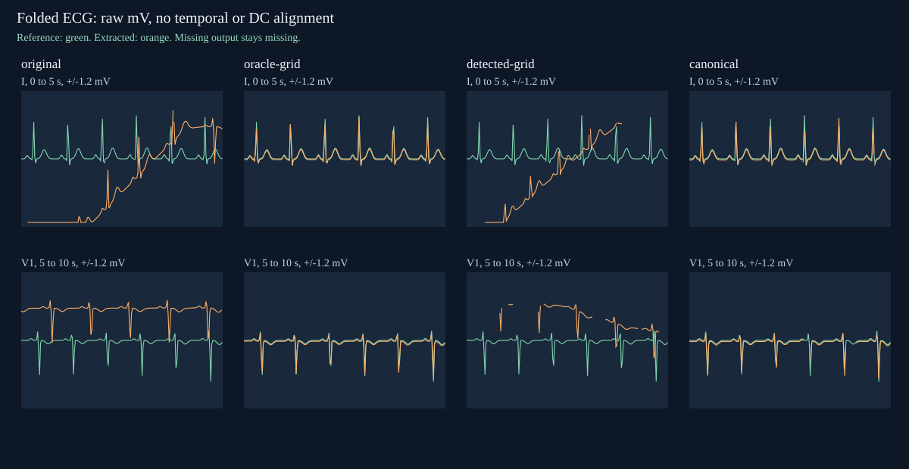

# Known-grid and detected-grid ECG rectification, 2026-10-21

Known 5 mm grid correspondences rescue the folded synthetic image while the
frozen model's own detected-grid control does not. No neural weights are trained.

| Case | Original SNR dB / coverage | Known grid SNR dB / coverage | Detected grid SNR dB / coverage | Clean texture SNR dB / coverage |
| --- | ---: | ---: | ---: | ---: |
| offline-flat | 18.26 / 99.95% | 21.39 / 99.95% | 13.18 / 79.98% | 22.36 / 81.72% |
| offline-fold | -7.72 / 98.20% | 20.74 / 99.07% | -6.05 / 90.79% | 21.06 / 92.57% |

On the folded image, known-grid correction improves conditional SNR by 28.46 dB.
On the identical 24,617 printed samples observed by all four arms, raw RMSE is
0.58059 mV for original RGB, 0.04510 mV for the known-grid result, 0.39388 mV
for the detected-grid result and 0.03861 mV for clean texture. The improvement
therefore survives a comparison on identical support, without time/DC alignment.
All arms select the expected layout family, which alone does not imply success.



## Design and interpretation

The two original RGBs are unchanged inputs from the preceding paper experiment.
The known-grid arm samples those photographs using visible generator grid
vertices at 5 mm spacing, with piecewise affine inverse sampling. Triangles
spanning missing lattice neighbors and out-of-hull pixels are rejected rather
than extrapolated. This sparse-grid oracle is not a pixel-perfect dense inverse.
Supported pixels cover 88.17% of the canonical canvas, including its signal area.
Unsupported RGB is white, with the support mask retained locally.

The automatic control receives RGB only for geometry. The frozen npj grid
segmentation, grid graph optimization and TPS produce the warp. The complete
aligned RGB is sampled before a fresh frozen digitization pass with nonlinear
dewarping disabled, so text and waveform share coordinates. This is a two-pass
upstream control, not a newly trained grid detector. It found 1,223 grid points
on flat paper and 586 on folded paper. Inspection finds residual deformation
and top-edge clipping in its folded output. No generator grid identities enter
that branch. The detected point counts are not recall measurements.

The clean texture is newly generated, unlit canonical RGB. It is a separate
control rather than recovered image content. It has lower printed coverage
than the oracle in both cases. Comparing conditional SNR alone would hide that.

The known-grid result establishes a recoverable geometry gap on this example.
It does not establish that point detection alone is sufficient. Correct grid
adjacency/identity, local warp fitting, cropping, scale and interpolation all
remain part of the automatic geometry problem. Next train or adapt a subpixel
point detector with the existing generator targets, assess topology/visibility,
and evaluate the complete signal chain on held-out sources and real images.

## Provenance, scoring and validation

The geometry replay verifies exact mesh, canonical texture and reference signal
hashes against the original capture. A one-SPP geometry replay saves cost, while
all remapping samples the original 64-SPP RGB. An initial replay with incomplete
print parameters was rejected by these checks, then corrected to use the complete
original clean-print profile. It contributes no reported measurement.

Initial clean-control PNGs failed checksum and decoding checks because their
files were truncated. They were rejected before inference. The controls were
regenerated from the verified generator configuration, saved through a complete
in-memory PNG buffer and checked pixel-for-pixel after writing. Old and verified
hashes are recorded separately. The failed attempt is not counted as a successful
control. The precise cause of that truncation was not established.

SNR uses per-lead observed printed samples, up to 100 ms alignment and DC removal.
It is not the Kaggle metric. Coverage, unsupported output, raw overlap errors
and raw errors on identical support are retained separately in summary.json.
There are two images and one artificial source signal. Gain and ten-second
output duration remain declared paper conventions. No real-image validation,
clinical inference, unknown-layout success or general robustness is claimed.

Four new coordinate/missingness/PNG tests pass. The final 56-test digitization
suite passes with reference artifacts. Full discovery before the final PNG
write guard ran 351 tests: 343 pass, six skip and two errors from the original
missing raster fixture. Strict E/F lint passes. Renderer source and frozen
fixtures are unchanged. CUDA was not run and no paid GPU was created.

## Reproduce

Prepare the original paper inputs and pinned upstream checkout as described in
`research/paper-adaptation/README.md`, then run:

```bash
OMP_NUM_THREADS=2 MKL_NUM_THREADS=2 \
python examples/digitization_grid_rectification.py \
  --inputs build/paper-adaptation-inputs \
  --source build/upstream/open-ecg-digitizer \
  --out build/grid-rectification
```

The code retains full per-arm reports, source hashes, projected-grid evidence,
input manifests, support masks, predictions and per-lead SVGs in that output.
